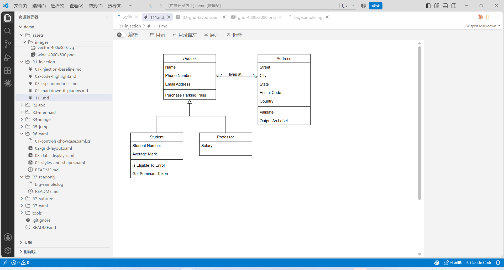
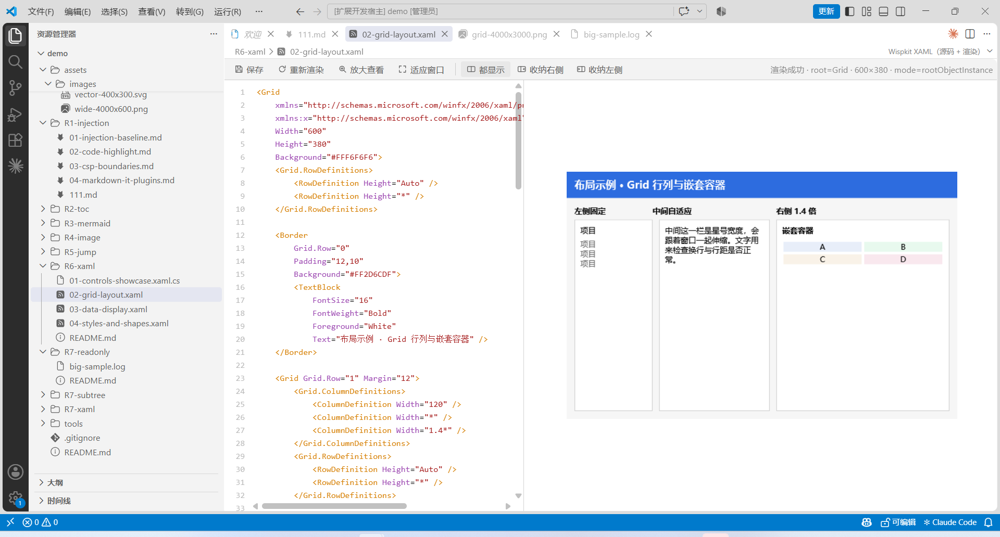
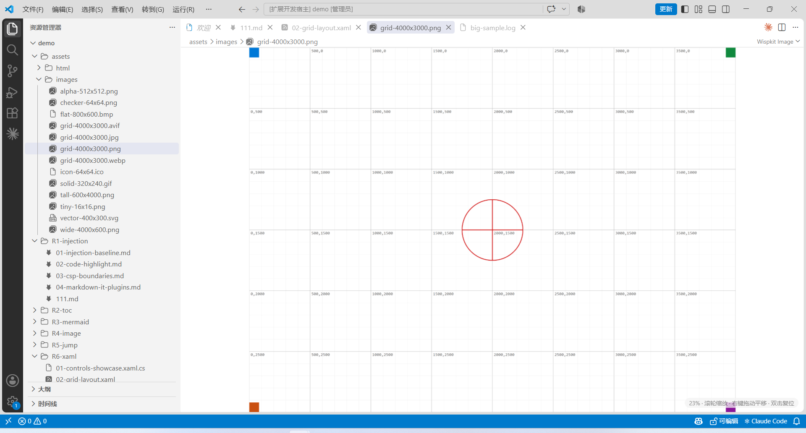
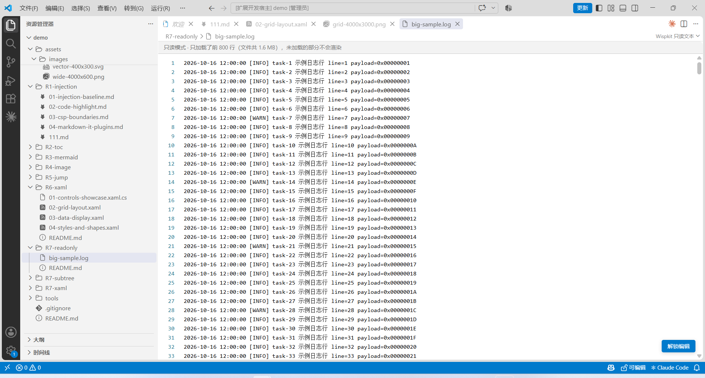
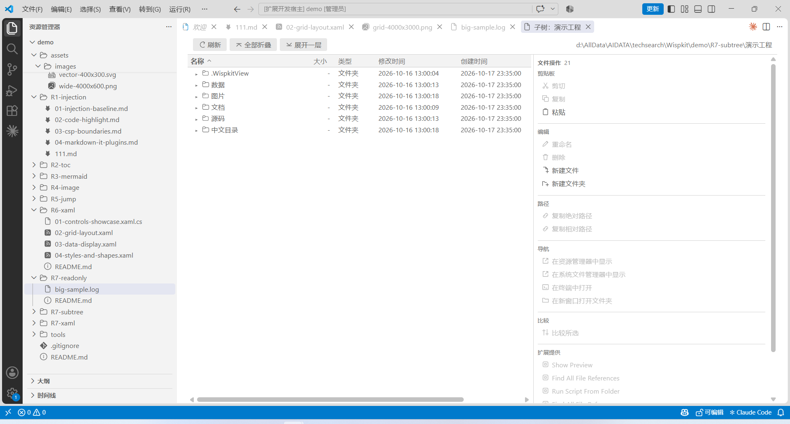

# Wispkit

[](https://github.com/isharrrry/wispkit/actions/workflows/ci.yml)
[](https://github.com/isharrrry/wispkit/releases)
[](LICENSE)
[](https://marketplace.visualstudio.com/items?itemName=harrrry.wispkit)

[English](README.md) | [中文](README.zh-CN.md) | **Español**

> Mejoras de navegación para VS Code. **Nunca parchea VS Code ni modifica ninguno de sus archivos**: siete editores personalizados gestionan Markdown / Mermaid / imágenes / vídeos / HTML / XAML / texto de solo lectura, más una vista de gestión de recursos personalizada en la barra de actividades, un panel de subárbol en el Explorador y un navegador 3D de gráficos para Markdown y Mermaid.

El host de la extensión es TypeScript puro (`engines.vscode: ^1.71.0`), desarrollado y verificado en Windows. La vista XAML incluye un renderizador .NET framework-dependent y requiere el runtime .NET 10 Windows Desktop; las otras seis vistas no tienen dependencias nativas.

## Qué problema resuelve

| Problema | Qué hace Wispkit |
|---|---|
| La vista previa de Markdown es una página muerta de solo lectura | Navegación en árbol + zoom por niveles en la barra de herramientas (50%–300%, Ctrl+rueda) + **búsqueda con Ctrl+F, resaltado y salto a la coincidencia** + menú contextual de medios + edición de drawio en el sitio + **edición del párrafo en el sitio** (edita el párrafo bajo el cursor, sin panel dividido ni otro editor); los documentos grandes (400 KB) llenos de diagramas y tablas se virtualizan para que saltar desde el índice siga siendo ágil |
| Los diagramas Mermaid / árboles ASCII de la documentación son planos y estáticos | **Navegación 3D de gráficos con un clic para Markdown**: clic derecho en `.md` → «Navegación 3D de gráficos», elige un gráfico por lado, rota / desplaza / hace zoom y fusiona grafos mediante nodos con el mismo nombre; las distribuciones «mutex» llevan el nodo central de cada gráfico a extremos opuestos y dejan los nodos de fusión en medio; muestra u oculta los nombres de las aristas y pasa el ratón por una burbuja para leer su comentario; un nodo Mermaid con etiqueta exactamente `void` (el marcador de «el otro lado no se creó») no dibuja burbuja y sus flujos pasan a ser flechas colgantes situadas en posiciones despejadas; si el nombre del nodo es `[texto](ruta de imagen)` y la imagen es válida, la burbuja muestra la imagen (esquinas sobre la esfera) |
| Un archivo `.mmd` es solo código fuente, sin vista gráfica | **Navegación de archivos Mermaid**: doble clic en `.mmd` / `.mermaid` para renderizar el diagrama; clic derecho en el mismo archivo para ver su topología en 3D |
| Ampliar una imagen exige Ctrl+rueda y no se puede arrastrar | La navegación de imágenes cubre PNG / JPG / GIF / BMP / ICO / WebP / AVIF / APNG / SVG y más; zoom con la rueda sin modificadores (anclado al cursor) + desplazamiento manteniendo el botón derecho + doble clic ajustar/100%, y SVG se redibuja como vector al nuevo tamaño para no perder nitidez. HEIF / TIFF / JXL no tienen decodificador en el runtime: muestran el motivo y ofrecen abrir con la aplicación predeterminada del sistema |
| Un archivo de vídeo en VS Code solo es binario | Doble clic en vídeos habituales (MP4 / WebM / MOV / MKV / AVI / WMV / FLV / RMVB…) los reproduce en un `<video>` nativo; los contenedores o códecs no soportados reciben el mismo respaldo de «abrir en el reproductor del sistema» |
| Los enlaces relativos y los `vscode://file/<ruta>:<línea>` de la documentación no abren (o acaban en el navegador del sistema) | Tanto la vista Markdown como la HTML enrutan los enlaces: las rutas relativas se resuelven respecto al documento y `vscode://file` / `#L<línea>` abren **en la ventana actual** en esa línea |
| Quieres ver cómo queda realmente una vista WPF | Fuente XAML y render **lado a lado**; el render se desplaza y amplía; los cambios se guardan en el archivo |
| Solo quieres leer, sin cargar el documento completo | Modo de solo lectura global: lee los primeros N bytes, **no crea ningún `TextDocument`** |
| El Explorador muestra una sola columna de nombres | Panel de subárbol: columnas configurables (tamaño/fecha/tipo/propietario…), área de acciones y herramientas propias |
| Las carpetas de uso frecuente están dispersas y exigen clics cada vez | **Gestión de recursos personalizada**: organízalas con grupos virtuales + carpetas (profundidad arbitraria) en la barra de actividades, con arrastre, importación/exportación y edición directa del JSON |

## Inicio rápido

```bash
npm install
npm run compile     # tsc + esbuild (8 bundles de webview)
npm test            # mocha, lógica pura, sin instanciar VS Code
npm run package     # genera wispkit-<version>.vsix
```

La CI de GitHub Actions ejecuta la misma puerta en cada push y pull request: `npm ci` → `npm run lint` → `npm run compile` → `npm test` (véase [compilación y verificación](docs/build-and-verify.es.md#ci)).

Instálala desde el [Visual Studio Marketplace](https://marketplace.visualstudio.com/items?itemName=harrrry.wispkit):

```bash
code --install-extension harrrry.wispkit
```

O construye el VSIX localmente e instálalo:

```powershell
code --install-extension .\wispkit-0.2.15.vsix --force
```

La vista XAML distribuye su renderizador como binarios precompilados: `tools/xaml-render/bin/Release/net10.0-windows/` está versionado y se empaqueta en el VSIX como **dependencia de ejecución, no como artefacto de compilación**. No lo borres ni lo regeneres para publicar; recompílalo solo si cambias el código del renderizador:

```powershell
cd tools\xaml-render
dotnet build -c Release
```

## Conceptos clave

1. **Editores personalizados, no parches** — siete `CustomEditorProvider` compiten por tipos de archivo. Markdown, Mermaid, imágenes, vídeos, HTML y XAML usan `priority: default` (toman el control); el texto de solo lectura usa `option` (cambio explícito). Para volver al editor integrado: *Reopen Editor With…* o `workbench.editorAssociations`.
2. **El host gestiona las rutas, la webview la interacción** — las URL de recursos dentro de una webview son `vscode-webview://` y **no se pueden revertir a una ruta real**. Por eso el menú contextual de medios informa solo "índice + tipo", y el host relee la ruta y el código fuente del texto Markdown; las imágenes se contrastan además con `alt`. Ver [arquitectura](docs/architecture.es.md).
3. **Renderizar con el pipeline integrado** — la extensión invoca el comando oculto `markdown.api.render`, de modo que los `markdown.markdownItPlugins` de terceros (mermaid, katex) se aplican solos, y luego emite `vscode.markdown.updateContent` sobre `window` para que los scripts de la webview vuelvan a renderizar. Ver [vistas e interacción](docs/views-and-interaction.es.md).
4. **Solo lectura significa "no cargado", no "edición prohibida"** — la vista previa lee solo los primeros N bytes, trunca por líneas, no construye `TextDocument` y nunca carga el archivo completo; un botón flotante "desbloquear edición" cambia al editor nativo. Ver [configuración](docs/configuration.es.md).
5. **Las aserciones deben morder el resultado, no "la regla existe"** — el repositorio ya se quemó con pruebas que validaban "se escribió una regla CSS" mientras el error real pasaba desapercibido; las pruebas actuales prefieren afirmar qué ocurrió después del clic. Ver [compilación y verificación](docs/build-and-verify.es.md).
6. **La navegación 3D analiza la topología; no porta el renderizador de Mermaid** — el host extrae nodos / aristas del Markdown o de un `.mmd` independiente y el front-end dibuja una escena 3D con three.js y su propio diseño. Cambia la paridad de píxeles con los temas de Mermaid por funcionamiento sin conexión (three.js viaja en un bundle local), un diseño testeable y cero CDN. Los materiales están en [`demo/R8-graph3d/`](demo/R8-graph3d/README.md).
7. **La gestión de recursos personalizada es un JSON normal dentro del espacio de trabajo** — los grupos virtuales solo nombran y agrupan y no tienen equivalente en disco; las carpetas se guardan con marcadores `${workspaceFolder}`; cada alta/renombrado/movimiento/borrado se escribe de inmediato en `.WispkitView/resource-tree.json` (archivo temporal hermano + rename), y las ediciones externas se recargan con Actualizar. Ver [vistas e interacción](docs/views-and-interaction.es.md#gestión-de-recursos-personalizada-wispkitresourcetree); los materiales están en [`demo/R9-resource-tree/`](demo/R9-resource-tree/README.md).

## Seguridad

- **Las vistas Markdown y XAML reutilizan la CSP Strict de la vista previa integrada** (`nonce` + `cspSource`, sin `unsafe-inline`), de modo que los scripts de terceros escritos para esa política funcionan sin cambios.
- **La vista HTML usa una CSP relajada** (permite scripts en línea y recursos http(s)) — navegar HTML exige por naturaleza que los scripts de la propia página se ejecuten; el nivel de riesgo es comparable al Simple Browser integrado. **No abras HTML de origen no confiable con ella.**
- "Guardar como" de medios y "guardar" de XAML escriben solo en una **ruta que tú elijas**; no se toca nada fuera del archivo destino.

## Documentación

| Para saber sobre | Lee |
|---|---|
| Qué se promete y cómo se juzga cada promesa | [Requisitos y criterios de aceptación](docs/requirements.es.md) |
| Objetivos de calidad, niveles de prueba y sus puntos ciegos, la puerta de integración, clasificación de defectos | [Restricciones de prueba y calidad](docs/test-and-quality.es.md) |
| Capas, responsabilidades de módulos, un flujo de datos completo | [Arquitectura](docs/architecture.es.md) |
| Interacción, gestos y contratos de mensajes de las siete vistas, la gestión de recursos personalizada, el panel de subárbol y la navegación 3D de gráficos | [Vistas e interacción](docs/views-and-interaction.es.md) |
| Referencia a nivel de campo de los 14 ajustes, `Wispkit.json`, marcadores de herramientas | [Configuración](docs/configuration.es.md) |
| Compilación, pruebas, sondas en máquina real, empaquetado | [Compilación y verificación](docs/build-and-verify.es.md) |
| Lo que no puede hacer y lo que nunca se verificó | [Limitaciones conocidas](docs/limitations.es.md) |
| Cómo se construyó paso a paso y cada tropiezo real | [Notas de desarrollo](docs/development-notes.zh-CN.md) (中文) |

**Regla de documentación**: cada tema en `docs/` existe en inglés, chino y español — **cualquier cambio actualiza los tres en el mismo cambio** (las variantes son traducciones fieles, no resúmenes). La única excepción es `docs/development-notes.zh-CN.md`, un registro de ingeniería interno que se mantiene solo en chino. Lo no verificado se etiqueta explícitamente en [Limitaciones conocidas](docs/limitations.es.md) en lugar de presentarse como garantía.

## Mantenimiento de este repositorio

**[Requisitos y criterios de aceptación](docs/requirements.es.md) es la única declaración autorizada de lo que esta extensión promete y de cómo se juzga cada promesa.** Cuando cualquier otro documento lo contradice, gana la página de requisitos y el otro documento es defectuoso.

| Si cambias | También debes actualizar | Porque |
|---|---|---|
| Cualquier comportamiento visible para el usuario | La entrada `R` / `AC` correspondiente en [Requisitos](docs/requirements.es.md) | Los requisitos preceden a la implementación; un documento que va por detrás del comportamiento es un defecto, no una tarea pendiente |
| La interacción o el gesto de cualquier vista | [Vistas e interacción](docs/views-and-interaction.es.md) y el material `demo/R<n>-*/` de esa vista | Un criterio solo vale la pena escribirlo si el siguiente lector puede reproducirlo |
| Cualquier ajuste | [Configuración](docs/configuration.es.md) y cada paquete `package.nls*.json` | Una clave de ajuste es un contrato externo; renombrarla en silencio rompe las configuraciones de los usuarios |
| Un recuento de pruebas, el tamaño del VSIX o cualquier resultado medido | [Restricciones de prueba y calidad](docs/test-and-quality.es.md) **y** [Compilación y verificación](docs/build-and-verify.es.md) | Un número debe venir de un comando realmente ejecutado, nunca de una estimación; la puerta y la cifra viven en dos archivos que deben moverse juntos |
| Cualquier documento | Las variantes en chino y español, **en el mismo cambio** | Un documento en un solo idioma es un defecto por sí mismo |
| Una vista o capacidad nueva | Un número `R` asignado en [Requisitos](docs/requirements.es.md) **primero**, y después la implementación | El número es la identidad del requisito; asignarlo después vuelve retroactiva la correspondencia con el material |

La tabla de temas de arriba y la del [índice de documentación](docs/index.es.md) también deben revisarse juntas: el índice puede desglosar un tema en filas más finas, pero ningún tema puede aparecer en una tabla y faltar en la otra.

## Compilación y entorno medido

| Ítem | Valor |
|---|---|
| Node / npm | **^22.22.2 / ^24.15.0 / >=26** (lo que acepta jsdom 30); la CI fija 22.22.2 y ejecuta `npm ci` → lint → compile → test en Windows |
| TypeScript | 5.7 |
| esbuild | 0.24 (8 bundles de webview; `graph3d` se minifica aparte) |
| Pruebas | mocha + jsdom, **1059 pasando**, 62 archivos de prueba |
| Bundle 3D | `media/dist/graph3d.js`, unos 603 KB (incluye three.js, minificado) |
| Lint | eslint 9, **0 errores** |
| VSIX | 172 entradas / ~1,71 MB (incluye docs, los tres README y las capturas) |
| VS Code medido | **1.137.0** (Windows) |

## Capturas de pantalla

Capturadas de un Extension Development Host real de VS Code 1.137.0, con la carpeta `demo/` incluida en este repositorio.

**Vista Markdown** — render de bloques drawio, tabla de contenidos, botón de edición y la insignia «Wispkit Markdown»:



**Vista XAML** — código resaltado junto al resultado renderizado; la línea de estado indica tipo raíz, tamaño y modo de alojamiento:



**Vista de imagen** — zoom con la rueda por defecto (sin Ctrl), arrastre con el botón derecho para desplazar, regla para comprobar la escala:



**Vista de texto de solo lectura** — solo se carga la cabecera del archivo (64 KB / 800 líneas por defecto); «Desbloquear edición» vuelve al editor nativo:



**Explorador de subárbol** — varias columnas (nombre / tamaño / tipo / modificación / creación), anchos arrastrables y acciones de archivo para la selección a la derecha. Admite arrastrar y soltar: los archivos soltados preguntan **copiar / mover**, mientras que mantener **Ctrl** al arrastrar una fila dentro del árbol (también entre dos paneles de subárbol) la mueve directamente sin preguntar; el texto / HTML / las imágenes piden un **tipo de almacenamiento y un nombre**; las entradas se pueden arrastrar fuera, al escritorio o al Explorador (los archivos arrastrados desde el sistema funcionan directamente, sin **Shift**):



## Comportamiento medido

Cada fila se ejecutó en un VS Code real, no es una intención de diseño:

| Verificación | Resultado |
|---|---|
| Menú contextual de medios en Markdown | 4 elementos para imágenes / 3 para mermaid / 4 para drawio; el portapapeles recibe el texto fuente exacto |
| Navegación 3D de gráficos (VS Code 1.137.0 real + revalidación del VSIX empaquetado) | entrada por menú contextual / paleta, reapertura que solo revela, recuento en el título, paneles 15%–85%, fusión y `Esc`, intervalo 0,25×–3×, actualización, restablecer vista, rotar con botón izquierdo / desplazar con derecho / zoom con rueda y adaptación a la ventana: todo pasado; 0 excepciones en el host o el webview |
| Navegación de archivos Mermaid (VS Code 1.137.0 real, host de desarrollo) | Al hacer doble clic en `demo/R8-graph3d/04-standalone.mmd` se abre `wispkit.mermaid` y se renderiza un SVG; el estado muestra `流程图 · 6 节点 · 6 边`; el menú contextual del Explorador contiene «Navegación 3D de gráficos»; Actualizar vuelve a renderizar un SVG; Fuente abre un editor de texto normal junto a la vista previa; al abrir el 3D desde la vista previa se obtiene `订单处理 · 流程图 · 6 节点 / 6 边` |
| Edición de drawio en el sitio | Bloque de código → archivo temporal → al guardar se reubica por contenido y se reescribe byte a byte |
| Renderizado XAML (controles reales de `Common.Resources` con `x:Class` y `Binding`) | **6/6 renderizados**; `Work.xaml` confirmado visualmente como la fila de botones "▶ ⏸ ⏹" |
| XAML de extremo a extremo en la webview | 3 ensamblados descubiertos → `ok:true` → imagen cargada 102×49 → 27 líneas de fuente → 0 violaciones de CSP / 0 errores de script |
| Iconos del subárbol frente al Explorador | Comparación CDP en máquina real de 6 archivos (`.md`/`.json`/`.mjs`) — **todos idénticos**; 3 usaban el genérico `file.svg` antes del arreglo |
| Enter dentro de un párrafo editable | Un Enter se rellena a línea en blanco y renderiza un párrafo nuevo; `Shift+Enter` mantiene el salto suave |
| Navegación de imágenes / vídeo (VS Code 1.137.0 real + sonda CDP) | SVG / WebP / AVIF se decodifican; el zoom de rueda en SVG cambia el tamaño de maquetación (400→440px) sin perder nitidez; HEIC muestra el panel de fallo de decodificación; MP4 carga metadatos a 160×90 / 2s y `currentTime` avanza al reproducir; un MKV corrupto muestra el respaldo de código de error 4; «Copiar ruta» llega al portapapeles; sonda **17/17** |
| Zoom / búsqueda / rendimiento con documentos grandes en Markdown (host de desarrollo real de VS Code 1.137.0 + sonda CDP 12/12) | Un documento de 243 KB con 400 títulos, 100 tablas y 27 diagramas mermaid se virtualiza automáticamente; los 27 diagramas se renderizan correctamente y no son omitidos por la virtualización; el zoom por pasos de la barra y el restablecimiento con Ctrl+0 funcionan; Ctrl+F encuentra 2416 coincidencias mediante la CSS Highlight API (0 `<mark>` en el DOM) y los contadores anterior/siguiente son correctos; un salto lejano desde el índice aterriza dentro de 0,04 px, y dentro de 0,75 px al 200% de zoom |
| Gestión de recursos personalizada (VS Code 1.137.0 real + revalidación del VSIX empaquetado) | Barra de actividades / pistas de árbol vacío, las seis entradas de la barra de título, añadir desde el menú contextual del Explorador, alta/renombrado/movimiento/borrado a profundidad arbitraria, arrastre interno y externo, rechazo de ciclos, apertura del subárbol, aviso al pulsar un grupo virtual, los tres estados de advertencia, conservación del estado al actualizar, avisos de borrado externo, cambio de configuración, actualización tras edición externa, JSON inválido no sobrescrito e importar / exportar / abrir JSON: todo pasado; 0 excepciones en el host o el webview |

Ninguna fila es una estimación. Los elementos no verificados están en [Limitaciones conocidas](docs/limitations.es.md).

## Limitaciones conocidas (resumen)

1. **Sin sincronización de desplazamiento editor↔vista previa** (sin mapeo de origen `data-line`); el resaltado del índice no depende de ello.
2. **Simple Browser no se puede interceptar** — es un webviewPanel creado por comando y nunca entra en la competencia de customEditors.
3. **XAML es una instantánea estática**: sin DataContext, sin manejadores de eventos, sin bucle de mensajes; `App.xaml` y los hosts `BlazorWebView` no tienen contenido visual (un host Blazor en blanco es **correcto**).
4. **La caja de edición de párrafo no tiene resaltado de sintaxis** — es un `<textarea>` simple, cambiando resaltado por alineación con el texto y cero dependencias.
5. **`atime` y los bits de permisos POSIX del subárbol son siempre `-`** — el `FileStat` de VS Code no los expone.
6. **Los temas de iconos basados en fuente (p. ej. Seti) no tienen respaldo** — los iconos del subárbol usan un sprite dibujado por la extensión; solo se analizan los temas basados en SVG.
7. **La navegación 3D es solo topología**: no reproduce temas ni estilos de Mermaid; los tipos de diagrama no admitidos caen en un encadenado por líneas; cada archivo Markdown se limita a 200 elementos y cada gráfico a 600 nodos; requiere WebGL.
8. **Gestión de recursos personalizada**: los grupos virtuales no tienen equivalente en disco; las rutas absolutas fuera del espacio de trabajo dejan de funcionar en otra máquina; no hay vigilancia de archivos, así que las ediciones externas requieren actualizar a mano y gana el último que escribe; los enlaces simbólicos y los enlaces rotos se verificaron en máquina real el 2026-10-26, mientras que el límite de permisos ausentes (en NTFS local el stat sigue funcionando) se documenta en la página de limitaciones; los espacios multitráiz se verificaron en máquina real el 2026-10-26 (véase la página de limitaciones); en cuanto a los sistemas de archivos remotos / virtuales, esta máquina no tiene entorno Remote-SSH / WSL / Dev Containers / Remote Tunnels, así que la escritura atómica solo se comprobó en un recurso compartido SMB de bucle local (véase el punto 13 sin verificar en la página de limitaciones).
9. **HEIF / HEIC y algunos contenedores de vídeo no se pueden decodificar in situ**: la decodificación se delega al runtime Chromium de VS Code; HEIF necesita libheif (varios MB) y TIFF / JXL / MKV / AVI / WMV / FLV / RMVB normalmente no tienen decodificador en el runtime. Siguiendo la regla de «sin dependencias grandes», esos formatos solo obtienen el respaldo de «abrir con la aplicación / reproductor del sistema»; MP4 (H.264/AAC) y WebM (VP8/VP9) sí se reproducen.

Los 27 elementos y la lista de no verificados están en [Limitaciones conocidas](docs/limitations.es.md).

## Licencia

MIT, ver [LICENSE](LICENSE).
