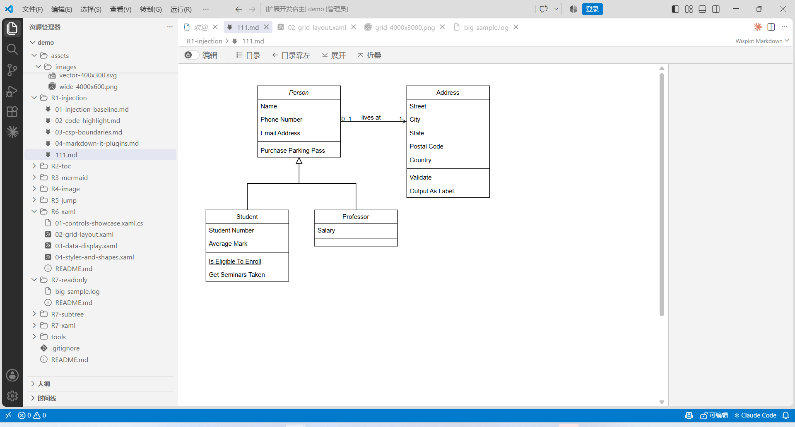
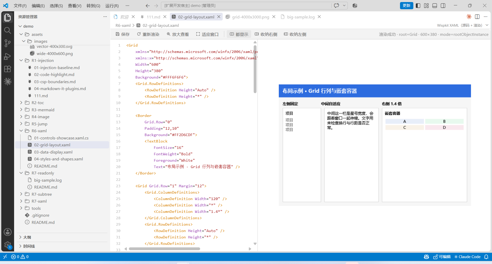
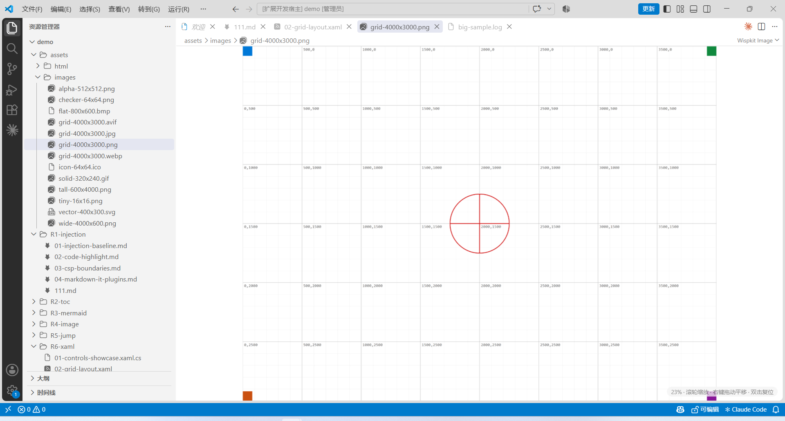
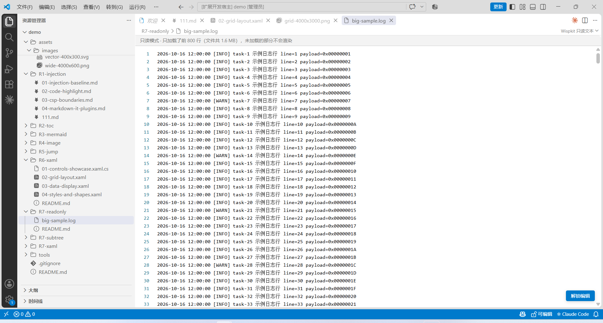
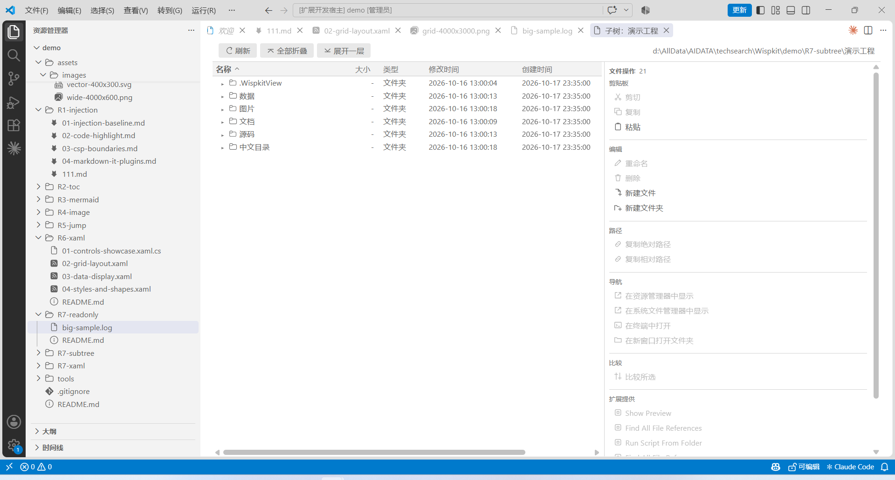

# Wispkit

[](https://github.com/isharrrry/wispkit/actions/workflows/ci.yml)
[](https://github.com/isharrrry/wispkit/releases)
[](LICENSE)
[](https://marketplace.visualstudio.com/items?itemName=harrrry.wispkit)

**English** | [中文](README.zh-CN.md) | [Español](README.es.md)

> Browsing enhancements for VS Code. It **never patches VS Code or modifies a single file of it** — seven custom editors carry Markdown / Mermaid / images / videos / HTML / XAML / read-only text, plus a custom resource management view in the Activity Bar, an Explorer subtree panel and a 3D graph browser for Markdown and Mermaid.

The extension host is plain TypeScript (`engines.vscode: ^1.71.0`), developed and verified on Windows. The XAML view ships a framework-dependent .NET renderer and needs the .NET 10 Windows Desktop runtime; the other six views have no native dependency.

## What problem it solves

| Problem | What Wispkit does |
|---|---|
| The Markdown preview is a read-only dead page | Tree navigation + multi-step toolbar zoom (50%–300%, Ctrl+wheel) + **Ctrl+F find with highlighting and jump-to-match** + media context menu + in-place drawio editing + **in-place paragraph editing** (edit the paragraph under the cursor — no split pane, no second editor); large (400 KB) documents full of diagrams and tables are virtualized so TOC jumps stay responsive |
| Mermaid / ASCII tree diagrams in docs are flat and static | **One-click 3D graph browsing for Markdown**: right-click `.md` → "3D visualization browsing", pick one graph per side, rotate / pan / zoom, and merge graphs through same-name nodes; the mutex layouts then push each graph's core node to opposite ends with fusion nodes in between; toggle edge names, and hover a node bubble to read its comment; a Mermaid node labelled exactly `void` (the "other side not created" placeholder) draws no bubble and its flows become dangling arrows placed around uncrowded positions; when a node name is `[text](image path)` and the image is valid, the bubble shows the image itself (corners on the bubble sphere) |
| A `.mmd` file is just source with no graphical preview | **Mermaid file browsing**: double-click `.mmd` / `.mermaid` to render the diagram; right-click the same file to browse its topology in 3D |
| Zooming an image needs Ctrl+wheel, and you cannot drag it | Image browsing covers PNG / JPG / GIF / BMP / ICO / WebP / AVIF / APNG / SVG and more; plain wheel zoom anchored at the cursor + hold-right-button pan + double-click fit/100%, with SVG re-rendered at the new layout size so it stays crisp. HEIF / TIFF / JXL have no decoder in the runtime, so they show the reason and offer one-click hand-off to the system default app |
| A video file is just binary inside VS Code | Double-click common videos (MP4 / WebM / MOV / MKV / AVI / WMV / FLV / RMVB…) to play them in a native `<video>`; unsupported containers or codecs get the same “open in system player” fallback |
| Relative links and `vscode://file/<path>:<line>` links from docs do not open (or get thrown at the system browser) | Both Markdown and HTML views route links: relative paths resolve against the document, while `vscode://file` and `#L<line>` open **in the current window** at that line |
| You want to see what a WPF view actually looks like | XAML source and render **side by side**; the render pans and zooms; edits save back to the file |
| You only want to read, without loading the whole document | Global read-only mode: reads the first N bytes, **creates no `TextDocument`** |
| The Explorer shows you one column of names | Subtree panel: configurable columns (size/time/type/owner…), an action area, custom tools |
| Frequently used folders are scattered and need a click path every time | **Custom resource management**: organise them with virtual groups + folders (arbitrary depth) in the Activity Bar, with drag and drop, import/export and direct JSON editing |

## Quick start

```bash
npm install
npm run compile     # tsc + esbuild (8 webview bundles)
npm test            # mocha, pure logic, no VS Code instance
npm run package     # produces wispkit-<version>.vsix
```

GitHub Actions CI runs the same gate on every push and pull request: `npm ci` → `npm run lint` → `npm run compile` → `npm test` (see [build and verify](docs/build-and-verify.md#ci)).

Install it from the [Visual Studio Marketplace](https://marketplace.visualstudio.com/items?itemName=harrrry.wispkit):

```bash
code --install-extension harrrry.wispkit
```

Or build the VSIX locally and install it:

```powershell
code --install-extension .\wispkit-0.2.15.vsix --force
```

The XAML view ships its renderer as prebuilt binaries: `tools/xaml-render/bin/Release/net10.0-windows/` is committed and packaged into the VSIX as a **runtime dependency, not a build artifact**. Do not delete or regenerate it for a release; rebuild only after changing the renderer source:

```powershell
cd tools\xaml-render
dotnet build -c Release
```

## Core concepts

1. **Custom editors, not patches** — seven `CustomEditorProvider`s compete for file types. Markdown, Mermaid, images, videos, HTML and XAML are `priority: default` (they take over); read-only text is `option` (explicit switch). To go back to the built-in editor: *Reopen Editor With…* or `workbench.editorAssociations`.
2. **The host owns paths, the webview owns interaction** — resource URLs inside a webview are `vscode-webview://` and **cannot be reverse-mapped to a real path**. So the media context menu reports only "index + kind", and the host re-reads the path and source from the Markdown text; images get an extra `alt` cross-check. See [architecture](docs/architecture.md).
3. **Render through the built-in pipeline** — the extension calls the built-in `markdown.api.render` command, so third-party `markdown.markdownItPlugins` (mermaid, katex) apply automatically, then dispatches `vscode.markdown.updateContent` on `window` so front-end scripts re-render. See [views and interaction](docs/views-and-interaction.md).
4. **Read-only means "not loaded", not "editing disabled"** — the preview reads only the first N bytes, truncates by line, builds no `TextDocument` and never loads the whole file; a floating "unlock editing" button switches to the native editor. See [configuration](docs/configuration.md).
5. **Assertions must bite the result, not "the rule exists"** — the repo has been burned by tests that verified "a CSS rule was written" while the real bug slipped through; current tests prefer to assert what happened after the click. See [build and verify](docs/build-and-verify.md).
6. **3D browsing parses topology; it does not port Mermaid's renderer** — the host extracts nodes / edges from Markdown or a standalone `.mmd` and the front end draws a 3D scene with three.js plus its own layout. It trades pixel parity with Mermaid themes for offline operation (three.js ships in a local bundle), a unit-testable layout and zero CDN. Fixtures live in [`demo/R8-graph3d/`](demo/R8-graph3d/README.md).
7. **Custom resource management is a plain JSON file inside the workspace** — virtual groups only name and group things and have no disk counterpart; folders are stored with `${workspaceFolder}` placeholders; every add/rename/move/delete is written immediately to `.WispkitView/resource-tree.json` (temporary sibling file + rename), and external edits reload with Refresh. See [views and interaction](docs/views-and-interaction.md#custom-resource-management-wispkitresourcetree); fixtures live in [`demo/R9-resource-tree/`](demo/R9-resource-tree/README.md).

## Safety

- **Markdown and XAML views reuse the built-in preview's Strict CSP** (`nonce` + `cspSource`, no `unsafe-inline`), so third-party preview scripts written against that policy work unchanged.
- **The HTML view uses a relaxed CSP** (inline scripts and http(s) resources allowed) — browsing HTML inherently requires the page's own scripts to run; the risk level is comparable to the built-in Simple Browser. **Do not open untrusted HTML with it.**
- "Save as" for media and "save" for XAML only write to a **path you picked** — nothing outside the target file is touched.

## Documentation

| To learn about | Read |
|---|---|
| What is promised, and how each promise is judged | [Requirements and acceptance criteria](docs/requirements.md) |
| Quality objectives, test levels and their blind spots, the merge gate, defect grading | [Test and quality constraints](docs/test-and-quality.md) |
| Layers, module responsibilities, one complete data flow | [Architecture](docs/architecture.md) |
| Interaction, gestures and message contracts of the seven views, custom resource management, the subtree panel and 3D graph browsing | [Views and interaction](docs/views-and-interaction.md) |
| Field-level reference for the 14 settings, `Wispkit.json`, tool placeholders | [Configuration](docs/configuration.md) |
| Build, tests, real-machine probes, packaging | [Build and verify](docs/build-and-verify.md) |
| What it cannot do, what was never verified | [Known limitations](docs/limitations.md) |
| How it was built step by step, and every pitfall hit | [Development notes](docs/development-notes.zh-CN.md) (中文) |

**Documentation rule**: every topic under `docs/` exists in English, Chinese and Spanish — **any edit updates all three in the same change** (variants are faithful translations, not summaries). The single exception is `docs/development-notes.zh-CN.md`, an internal engineering log kept in Chinese only. Unverified items are labelled explicitly in [Known limitations](docs/limitations.md) instead of being presented as guarantees.

## Maintaining this repository

**[Requirements and acceptance criteria](docs/requirements.md) is the single authoritative statement of what this extension promises and how each promise is judged.** Where any other document disagrees with it, the requirements page wins and the other document is defective.

| If you change | You must also update | Because |
|---|---|---|
| Any user-visible behaviour | The matching `R` / `AC` entry in [Requirements](docs/requirements.md) | Requirements precede implementation; a document that trails behaviour is a defect, not a backlog item |
| Any view's interaction or gesture | [Views and interaction](docs/views-and-interaction.md) and that view's `demo/R<n>-*/` fixture | A criterion is only worth writing if the next reader can replay it |
| Any setting | [Configuration](docs/configuration.md) and every `package.nls*.json` bundle | A setting key is an external contract; renaming one silently breaks users' configurations |
| A test count, a VSIX size or any measured result | [Test and quality constraints](docs/test-and-quality.md) **and** [Build and verify](docs/build-and-verify.md) | A number must come from a command that was actually run, never from an estimate; the gate and the figure are recorded in two files that have to move together |
| Any document | The Chinese and Spanish variants, **in the same change** | A single-language document is a defect in its own right |
| A new view or capability | An `R` number allocated in [Requirements](docs/requirements.md) **first**, then the implementation | The number is the requirement's identity; allocating it afterwards makes the fixture mapping retroactive |

The topic table above and the one in the [documentation index](docs/index.md) must be revised together: the index may break a topic into finer-grained rows, but no topic may appear in one table and be missing from the other.

## Build and measured environment

| Item | Value |
|---|---|
| Node / npm | **^22.22.2 / ^24.15.0 / >=26** (what jsdom 30 accepts); CI pins 22.22.2 and runs `npm ci` → lint → compile → test on Windows |
| TypeScript | 5.7 |
| esbuild | 0.24 (8 webview bundles; `graph3d` is minified separately) |
| Tests | mocha + jsdom, **1059 passing**, 62 test files |
| 3D bundle | `media/dist/graph3d.js`, about 603 KB (three.js included, minified) |
| Lint | eslint 9, **0 errors** |
| VSIX | 172 entries / ~1.71 MB (docs, the three READMEs and the screenshots included) |
| Measured VS Code | **1.137.0** (Windows) |

## Screenshots

Captured from a real VS Code 1.137.0 Extension Development Host, using the `demo/` folder shipped in this repository.

**Markdown view** — drawio block rendering, table of contents, edit toggle and the "Wispkit Markdown" badge:



**XAML view** — highlighted source next to the rendered result; the status line reports root type, size and hosting mode:



**Image view** — wheel zoom by default (no Ctrl needed), right-drag to pan, ruler to check the zoom ratio:



**Read-only text view** — only the head of the file is loaded (64 KB / 800 lines by default); "Unlock editing" switches back to the native editor:



**Subtree browser** — multiple columns (name / size / type / modified / created), draggable widths, and per-selection file actions on the right. Drag and drop is supported: dropped files ask **copy / move**, while holding **Ctrl** when dragging a row inside the tree (including between two side-by-side subtree panels) moves it directly with no prompt; text / HTML / images ask for a **storage type and name**; entries can be dragged out to the desktop or Explorer (files dragged in from the OS work directly, no **Shift** needed):



## Measured behaviour

Every row below ran in a real VS Code, not a design intent:

| Verification | Result |
|---|---|
| Markdown media context menu | 4 items for images / 3 for mermaid / 4 for drawio; the clipboard receives the exact source text |
| 3D graph browsing (real VS Code 1.137.0 + packaged-VSIX re-check) | context-menu / command-palette entry, re-open only reveals, title count, 15%–85% split panes, merge and `Esc`, spacing 0.25×–3×, refresh, reset view, left-drag rotate / right-drag pan / wheel zoom and window resizing all passed; 0 extension-host or webview exceptions |
| Mermaid file browsing (real VS Code 1.137.0, extension development host) | Double-clicking `demo/R8-graph3d/04-standalone.mmd` opens `wispkit.mermaid` and renders an SVG; status shows `流程图 · 6 节点 · 6 边`; the Explorer context menu contains "3D visualization browsing"; Refresh still renders an SVG; Source opens an ordinary text editor beside the preview; opening 3D from the preview yields `订单处理 · 流程图 · 6 节点 / 6 边` |
| In-place drawio editing | Code block → temp file → save re-locates by content and writes back byte-identically |
| XAML rendering (real `Common.Resources` controls with `x:Class` and `Binding`) | **6/6 rendered**; `Work.xaml` visually confirmed as the "▶ ⏸ ⏹" button row |
| XAML end-to-end in the webview | 3 assemblies discovered → `ok:true` → image loaded 102×49 → 27 source lines → 0 CSP violations / 0 script errors |
| Subtree icons vs Explorer | Real-machine CDP comparison of 6 files (`.md`/`.json`/`.mjs`) — **all identical**; 3 of them were the generic `file.svg` before the fix |
| Enter inside an editable paragraph | A single Enter is padded to a blank line and renders a new paragraph; `Shift+Enter` stays a soft break |
| Image / video browsing (real VS Code 1.137.0 + CDP probe) | SVG / WebP / AVIF decode; SVG wheel zoom changes the layout size (400→440px) without blurring; HEIC shows the decode-failure panel; MP4 loads metadata at 160×90 / 2s and `currentTime` advances during playback; a corrupt MKV shows the error-code-4 fallback; "Copy path" reaches the clipboard; probe **17/17** |
| Markdown zoom / find / large-document performance (real VS Code 1.137.0 dev host + CDP probe 12/12) | A 243 KB document with 400 headings, 100 tables and 27 mermaid diagrams virtualizes automatically; all 27 diagrams render correctly and are not skipped by virtualization; toolbar step zoom and Ctrl+0 reset work; Ctrl+F finds 2416 matches through the CSS Highlight API (0 `<mark>` in the DOM) and previous/next counts are correct; a far TOC jump lands within 0.04 px, and within 0.75 px at 200% zoom |
| Custom resource management (real VS Code 1.137.0 + packaged-VSIX re-check) | Activity Bar / empty-tree hints, the six title-bar entries, adding from the Explorer context menu, arbitrary-depth add/rename/move/delete, internal and external drag and drop, cycle rejection, opening the subtree panel, the virtual-group click notice, the three warning states, refresh state preservation, external-deletion warnings, configuration switching, refresh after an external edit, invalid JSON not overwritten, and import / export / open JSON all passed; 0 extension-host or webview exceptions |

No row is an estimate. Unverified items are listed in [Known limitations](docs/limitations.md).

## Known limitations (summary)

1. **No editor↔preview scroll sync** (no `data-line` source mapping); TOC highlighting does not depend on it.
2. **Simple Browser cannot be taken over** — it is a command-created webviewPanel and never enters customEditors competition.
3. **XAML is a static snapshot**: no DataContext, no event handlers, no message loop; `App.xaml` and `BlazorWebView` hosts have no visual content (a blank Blazor host is **correct**).
4. **The paragraph edit box has no syntax highlighting** — it is a plain `<textarea>`, trading highlighting for alignment with the text and zero dependencies.
5. **Subtree `atime` and POSIX permission bits are always `-`** — VS Code's `FileStat` does not expose them.
6. **Font-based icon themes (e.g. Seti) do not fall back** — subtree icons use a self-drawn sprite; only SVG-based themes are parsed.
7. **3D browsing is topology only**: it does not reproduce Mermaid themes or styling; unsupported diagram types fall back to chaining lines; each Markdown file is capped at 200 graph elements and each graph at 600 nodes; WebGL is required.
8. **Custom resource management**: virtual groups have no disk counterpart; absolute paths outside the workspace break on another machine; there is no file watcher, so external edits need a manual refresh and the last writer wins; symlinks and broken links were verified on a real machine on 2026-10-26, while the permission-denied boundary (stat still succeeds on local NTFS) is documented on the limitations page; multi-root workspaces were verified on a real machine on 2026-10-26 (see the limitations page); for remote / virtual file systems, this machine has no Remote-SSH / WSL / Dev Containers / Remote Tunnels environment, so atomic writes were only checked on an SMB loopback share (see unverified item 13 on the limitations page).
9. **HEIF / HEIC and some video containers cannot be decoded in place**: decoding is delegated to VS Code's Chromium runtime; HEIF needs libheif (several MB), and TIFF / JXL / MKV / AVI / WMV / FLV / RMVB mostly have no runtime decoder. Following the "no large dependencies" rule, those formats only get the "open in system app / player" fallback; MP4 (H.264/AAC) and WebM (VP8/VP9) really play.

All 27 items plus the unverified list are in [Known limitations](docs/limitations.md).

## License

MIT, see [LICENSE](LICENSE).
