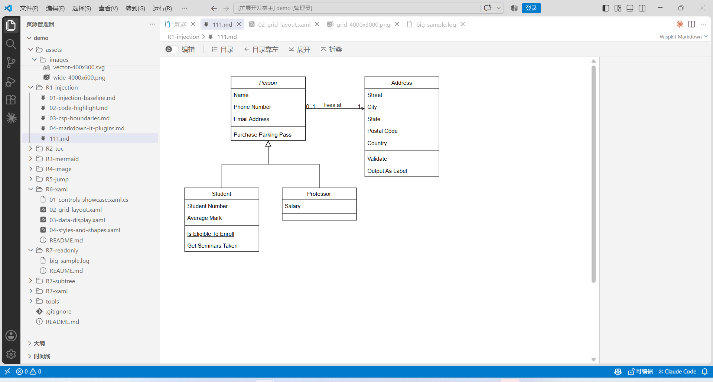
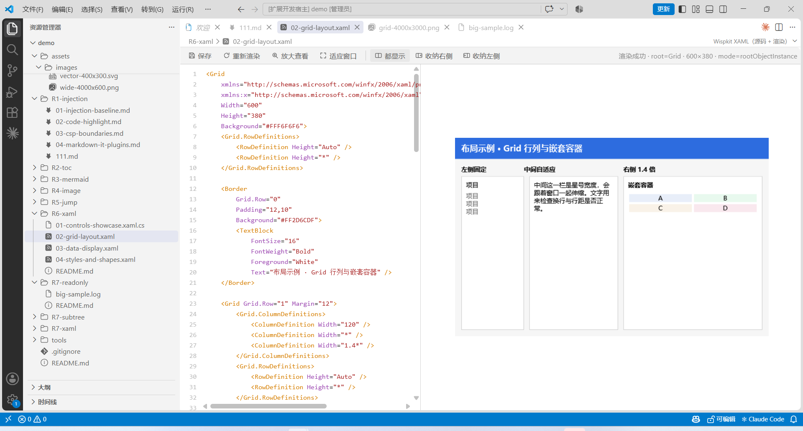
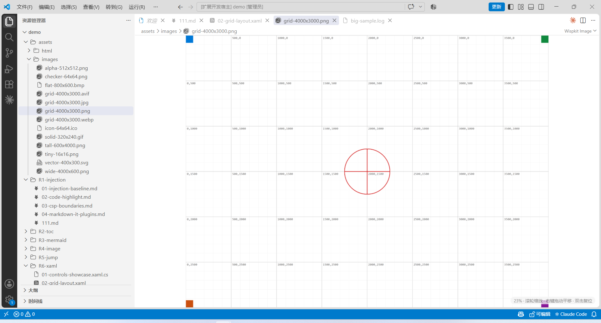
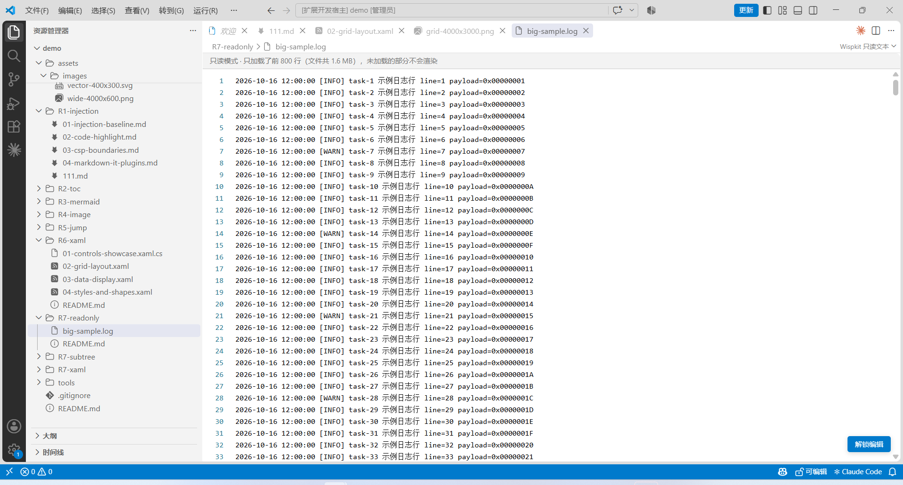
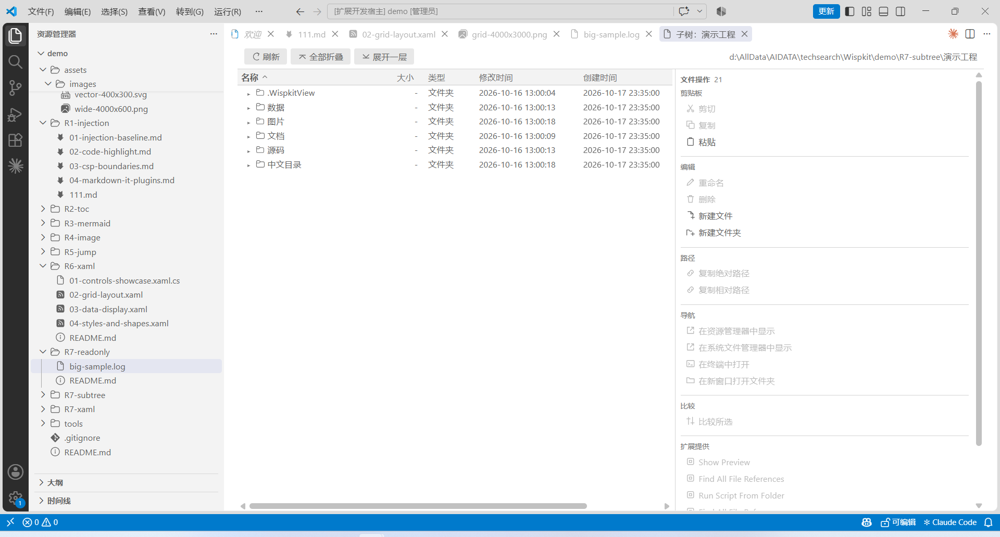

# Wispkit

[English](README.md) | **中文** | [Español](README.es.md)

> VS Code 的浏览增强扩展。**不修改 VS Code 任何文件、不依赖补丁**，用 5 个自定义编辑器承载 Markdown / 图片 / HTML / XAML / 只读文本，另加一个资源管理器子树面板。

扩展宿主是纯 TypeScript（`engines.vscode: ^1.71.0`），在 Windows 上开发与验证。XAML 视图附带一个 framework-dependent 的 .NET 渲染器，需要 .NET 10 的 Windows Desktop 运行时；其余 4 个视图零原生依赖。

## 它解决什么问题

| 问题 | Wispkit 的做法 |
|---|---|
| Markdown 预览是个"只读死页面" | 目录树导航 + 媒体右键菜单 + drawio 就地编辑 + **光标段落就地编辑**（点哪段改哪段，不分栏、不新开编辑器） |
| 图片要看细节得按 Ctrl 滚轮，还没法拖 | 默认滚轮缩放（光标为锚点）+ 按住右键拖动平移 + 双击 fit/100% |
| 文档里的 `vscode://file/<路径>:<行号>` 点不开 | 改写成 `command:vscode.open?<args>`，在**当前窗口**打开并定位 |
| 想看一个 WPF 视图长什么样 | XAML 源码与渲染**并排**，渲染可缩放平移，改完可保存回文件 |
| 只想读一读，不想改动也不想要完整加载 | 全局只读模式：只读文件头若干字节、**不创建 TextDocument** |
| 资源管理器只能一列名称看目录 | 子树面板：列可配置（大小/时间/类型/用户…）、右侧操作区、自定义工具 |

## 快速开始

```bash
npm install
npm run compile     # tsc + esbuild（4 个 webview bundle）
npm test            # mocha，纯逻辑，不启动 VS Code
npm run package     # 产出 wispkit-<version>.vsix
```

安装到本机 VS Code（把路径换成你的 `code.cmd`）：

```powershell
& "D:\app\VSCodeEXE\bin\code.cmd" --install-extension .\wispkit-0.1.0.vsix --force
```

XAML 视图需要先构建随扩展分发的渲染器：

```powershell
cd tools\xaml-render
dotnet build -c Release
```

## 核心概念

1. **用自定义编辑器，不补丁 VS Code** — 5 个 `CustomEditorProvider` 竞争打开方式；Markdown / 图片 / XAML 是 `priority: default`（默认接管），HTML / 只读文本是 `option`（要显式切换）。想退回内置：*Reopen Editor With…* 或 `workbench.editorAssociations`。
2. **宿主定路径，前端定交互** — webview 里的资源地址是 `vscode-webview://`，**反解不出真实路径**；所以媒体右键只上报「第几个元素 + 类型」，路径与源码由宿主回 Markdown 原文里取，图片再用 `alt` 交叉校验。详见 [架构](docs/architecture.zh-CN.md)。
3. **渲染走内置管线，不自己实现 Markdown** — 用内置引擎的隐藏命令 `markdown.api.render`，这样第三方 `markdown.markdownItPlugins`（mermaid、katex）自动生效；内容更新后在 `window` 派发 `vscode.markdown.updateContent` 让前端脚本重渲染。详见 [视图与交互](docs/views-and-interaction.zh-CN.md)。
4. **只读 = 不加载，不是禁编辑** — 只读预览读文件头若干字节、按行截断，不构建 `TextDocument`、不整份进内存；右下角「解锁编辑」切回原生编辑器。详见 [配置参考](docs/configuration.zh-CN.md)。
5. **断言要咬结果，不是咬"规则存在"** — 仓库踩过只验证"CSS 规则写了"却漏掉真 bug 的坑；现存测试尽量断言"点完之后发生了什么"。详见 [构建与验证](docs/build-and-verify.zh-CN.md)。

## 安全边界

- **Markdown / XAML 视图沿用内置 Markdown 预览的 Strict 级 CSP**（`nonce` + `cspSource`，无 `unsafe-inline`），第三方预览脚本按该策略编写即可正常工作。
- **HTML 视图是宽松 CSP**（放行内联脚本与 http(s) 资源）—— 浏览 HTML 本身就需要页面自带脚本能跑，风险等级与内置 Simple Browser 相当。**不要用它打开不可信来源的 HTML。**
- 媒体「另存为」与 XAML「保存」都写回**用户主动指定的路径**，不覆盖原文件之外的任何位置。

## 文档

| 想了解 | 读 |
|---|---|
| 分层、模块职责、一次完整数据流 | [架构](docs/architecture.zh-CN.md) |
| 5 个视图与子树面板的交互、手势、消息契约 | [视图与交互](docs/views-and-interaction.zh-CN.md) |
| 每个配置项的字段级参考、`Wispkit.json`、工具占位符 | [配置参考](docs/configuration.zh-CN.md) |
| 构建、测试、真机探针、打包安装 | [构建与验证](docs/build-and-verify.zh-CN.md) |
| 做不到的事、没验证过的事 | [已知限制与未验证项](docs/limitations.zh-CN.md) |
| 一步步是怎么做出来的、每个真实踩过的坑 | [开发过程与踩坑](docs/development-notes.zh-CN.md) |

**文档纪律**：`docs/` 下每篇主题都有英/中/西三个版本，**任何修改必须在同一次改动里同步更新三份**（语言变体是忠实翻译，不是摘要）。唯一例外是 `docs/development-notes.zh-CN.md`——内部工程记录，仅中文。未验证项一律在[已知限制](docs/limitations.zh-CN.md)显式标注，不当作设计保证陈述。

## 构建与实测环境

| 项 | 值 |
|---|---|
| Node / npm | 本机实测构建通过（`npm run compile`） |
| TypeScript | 5.7 |
| esbuild | 0.24（4 个 webview bundle） |
| 测试 | mocha + jsdom，**477 passing**，20 个测试文件 |
| lint | eslint 9，**0 error** |
| VSIX | 94 条目 / 约 1.1 MB（含 docs、三语 README 与界面截图） |
| 实测 VS Code | **1.137.0**（Windows） |

## 界面截图

截图取自真实 VS Code 1.137.0 的扩展开发宿主，素材是仓库自带的 `demo/`。

**Markdown 视图** —— drawio 图块渲染、目录导航、编辑开关与「Wispkit Markdown」徽标：



**XAML 视图** —— 源码高亮与渲染结果并排，状态行给出根类型、尺寸与承载模式：



**图片视图** —— 默认滚轮缩放（无需按 Ctrl）、右键拖动平移，标尺用于核对缩放比例：



**只读文本视图** —— 只加载文件头（默认 64 KB / 800 行），右下角「解锁编辑」切回原生编辑器：



**子树浏览** —— 多列（名称 / 大小 / 类型 / 修改时间 / 创建时间）、列宽可拖，右侧是选中条目的文件操作分组：



## 实测过的行为

以下每一条都在真实 VS Code 里跑过，不是设计意图：

| 验证项 | 结果 |
|---|---|
| Markdown 媒体右键菜单 | 图片 4 项 / mermaid 3 项 / drawio 4 项全部出现；点击后剪贴板拿到正确原文 |
| drawio 就地编辑 | 抽出代码块 → 临时文件 → 保存后按内容重新定位回写，逐字一致 |
| XAML 渲染（`Common.Resources` 真实控件，带 `x:Class` 与 `Binding`） | **6/6 渲染成功**；`Work.xaml` 目视确认为「▶ ⏸ ⏹」按钮组 |
| XAML 端到端 webview | 自动发现 3 个程序集 → `ok:true` → 图片加载 102×49 → 27 行源码 → CSP 违规 0 / 脚本错误 0 |
| 子树图标与资源管理器一致性 | 真机 CDP 对照 6 个文件（`.md`/`.json`/`.mjs`）**全部一致**；修复前 3 个是通用 `file.svg` |
| 编辑段回车 | 单个回车补成空行 → 渲染出新段落；`Shift+回车` 为段内换行 |

没有一行是估计。未验证项集中列在 [已知限制与未验证项](docs/limitations.zh-CN.md)。

## 已知限制（摘要）

1. **没有编辑器↔预览的滚动同步**（不做 `data-line` 源映射）；目录导航的高亮与定位不依赖它。
2. **Simple Browser 无法被接管** —— 它是命令创建的 webviewPanel，不走 customEditors 竞争。
3. **XAML 是静态快照**：无 DataContext、不跑事件处理器、不启动消息循环；`App.xaml` 与 `BlazorWebView` 场景没有可视内容（后者空白是**正确**的）。
4. **段落编辑框无语法高亮**：它是纯 `<textarea>`，换来与正文的行对齐和零依赖。
5. **子树视图的 `atime` 与 POSIX 权限位恒为 `-`** —— VS Code 的 `FileStat` 不暴露这两项。
6. **字体形态的图标主题（如 Seti）不回退**：子树图标走自绘 sprite，只有 SVG 形态的主题会被解析。

完整 14 条 + 未验证清单见 [已知限制](docs/limitations.zh-CN.md)。

## 许可证

MIT，见 [LICENSE](LICENSE)。
