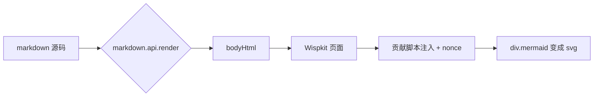

# R1-01 注入基线：贡献脚本 + 贡献样式

> **验证点**：Wispkit 把**其他扩展**声明的 `markdown.previewScripts` / `markdown.previewStyles`
> 注入了自己的页面，并且给了 nonce、在 CSP 里放行。
> **一句话判据**：下面的 Mermaid 图如果显示成**图形**，说明这两件事同时成立
> （脚本没被注入 → 只剩一块代码；注入了但 CSP 没放行 → 也是一块代码或空白）。

## 1. 贡献脚本是否真的执行了（内置 mermaid 扩展）



**期望**：上面是一张有箭头、有圆角框的图。
**失败长什么样**：
- 看到一段带 `graph LR` 的代码块 → 脚本没注入，或 fence 没被转成 `div.mermaid`
- 看到一块空白 / 高度为 0 的空框 → 脚本注入了但没跑（CSP 把脚本拦了）

## 2. 贡献样式是否真的生效（KaTeX）

行内公式 $a^2 + b^2 = c^2$ 与块级公式：

$$\int_0^1 x^2\,dx = \frac{1}{3}$$

**期望**：公式是**排版好的数学符号**（分数有横线、积分号是拉长的），不是原始文本 `\frac{1}{3}`。
这依赖 `markdown-math` 扩展贡献的 `markdown.previewStyles`（KaTeX 的 css）。

### 备注标题

## 3. 多语言代码高亮（内置 highlight.css 也走同一条通路）

```javascript
const contributions = collectMarkdownContributions(extensions);
// 期望：const / comments / strings 颜色不同
```

```python
def greet(name: str) -> str:
    return f"hello {name}"  # 期望：关键字与字符串颜色不同
```

**期望**：两种语言的 token 有**不同颜色**。全黑 = highlight 样式没注入。

## 4. 组合检查表

| 看到的现象 | 结论 |
|---|---|
| 图是图形 + 公式排版正常 + 代码有色 | R1 通过 |
| 图是图形但公式是原始 LaTeX | 脚本注入了，样式没注入（或 katex css 缺失） |
| 图是代码块 + 代码无色 | 脚本和样式都没注入 |
| 控制台报 `Refused to execute inline script` 之类 | CSP 与 nonce 不匹配（**这是 R1 的核心失败**） |

> 想看控制台：命令面板 → **Developer: Open Webview Developer Tools** → Console。
