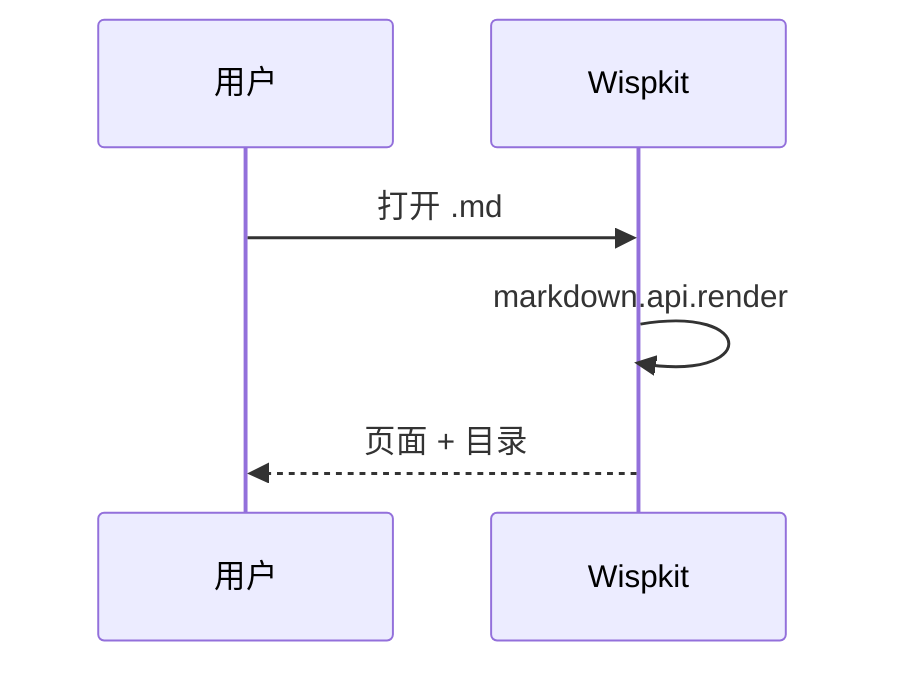

# R1-04 markdownItPlugins 通路

> **验证点**：Wispkit 不自己写 Markdown 解析器，而是复用内置引擎的隐藏命令
> `markdown.api.render`。这个命令会把**所有扩展**通过 `markdown.markdownItPlugins`
> 注册的插件应用上去。所以下面这些"非标准 Markdown"都该正常工作。

## 1. 数学（markdown-math 的 markdownItPlugins）

行内：$e^{i\pi} + 1 = 0$

块级：

$$
\begin{aligned}
\nabla \cdot \mathbf{E} &= \frac{\rho}{\varepsilon_0} \\
\nabla \cdot \mathbf{B} &= 0
\end{aligned}
$$

**期望**：两处都是排版好的公式。

## 2. Mermaid fence 转 div（mermaid 扩展的 markdownItPlugins）

**期望**：渲染成时序图，而不是代码块。

## 3. 标准 Markdown 也要正常（回归基线）

| 语法 | 结果 |
|---|---|
| **粗体** | 粗体 |
| *斜体* | 斜体 |
| ~~删除线~~ | 删除线 |
| `行内代码` | 行内代码 |
| [链接](https://code.visualstudio.com) | 链接 |

- [x] 任务列表已完成项
- [ ] 任务列表未完成项

> 引用块第一层
> > 引用块第二层

---

## 4. 脚注与定义（看内置引擎支持到哪）

带脚注的句子[^1]。

[^1]: 这是脚注内容。

**期望**：如果内置引擎支持脚注，应渲染成可跳转的脚注；不支持则原样显示——**两种都不算 R1 的失败**，这只是记录内置引擎的能力边界。

## 5. 失败长什么样

| 现象 | 说明 |
|---|---|
| 公式显示成 `$e^{i\pi} + 1 = 0$` 原文 | `markdown.api.render` 没被调通，或 markdown-math 没装 |
| Mermaid 显示成代码块 | mermaid 扩展没贡献 markdownItPlugins，或渲染命令走错了通路 |
| 整篇不渲染、只显示 "Wispkit 无法渲染该文档" | 渲染命令抛异常（页面上会带出错误文本） |

> 最后一种情况页面里会有 `
`，里面就是 `markdown.api.render` 的原始报错——**那条报错信息请原样贴给我**。
