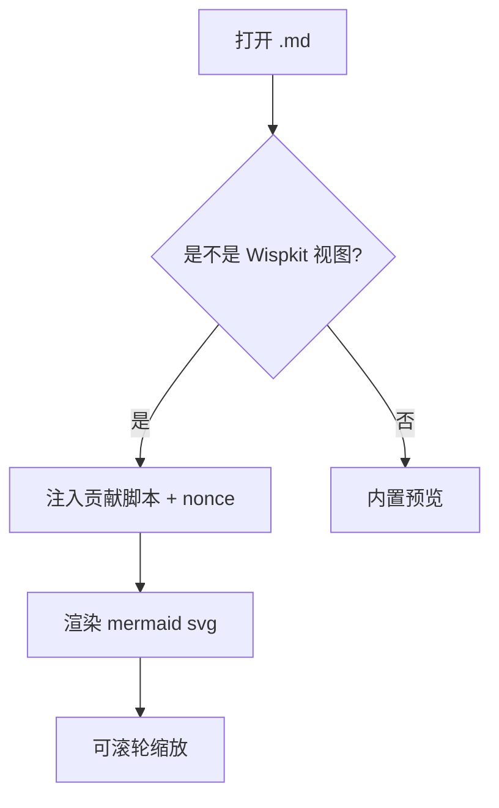
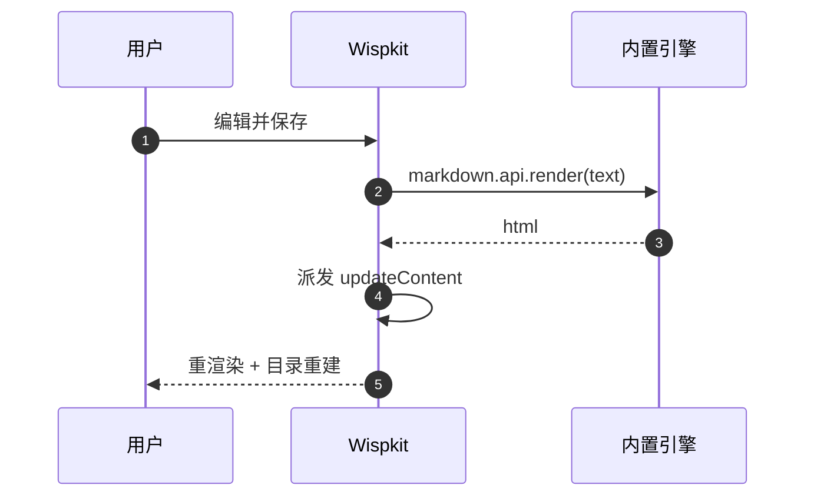
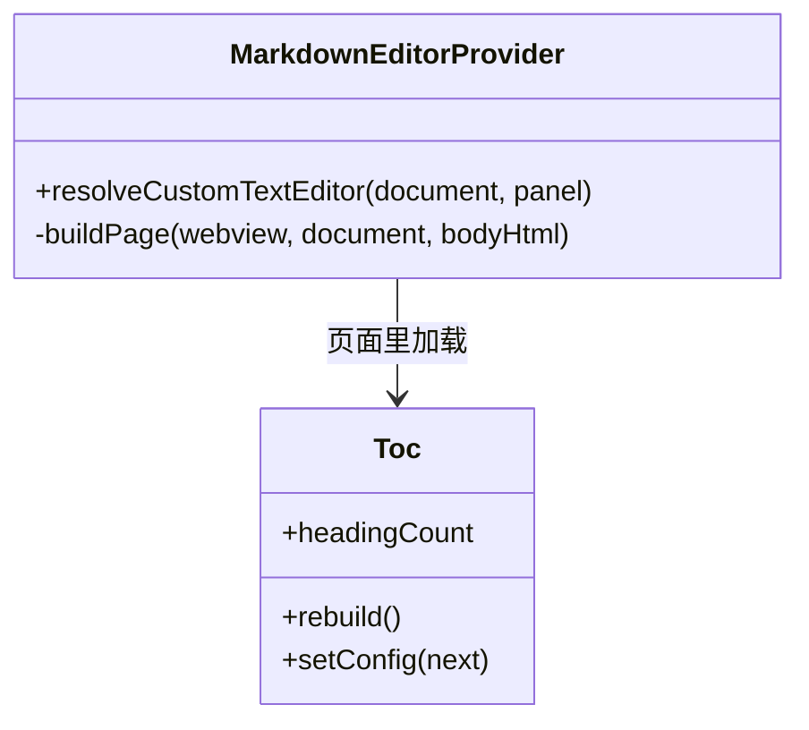
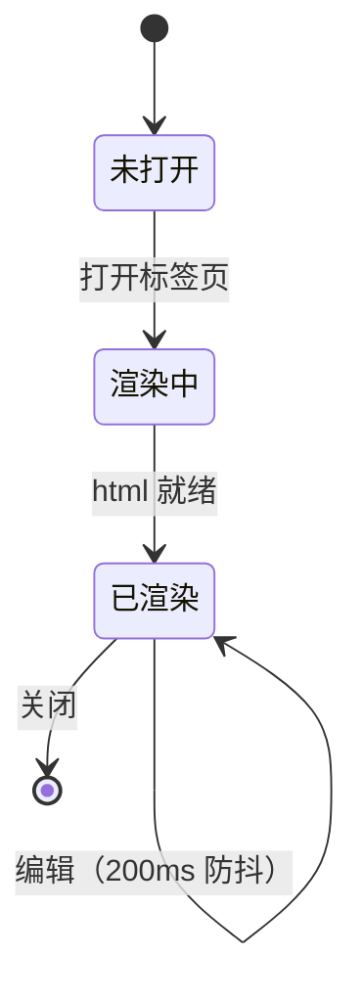
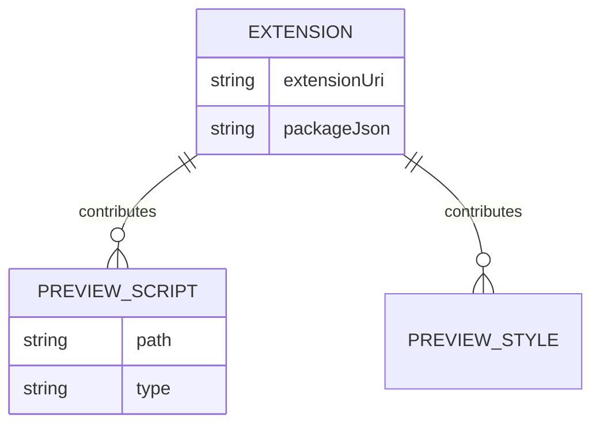
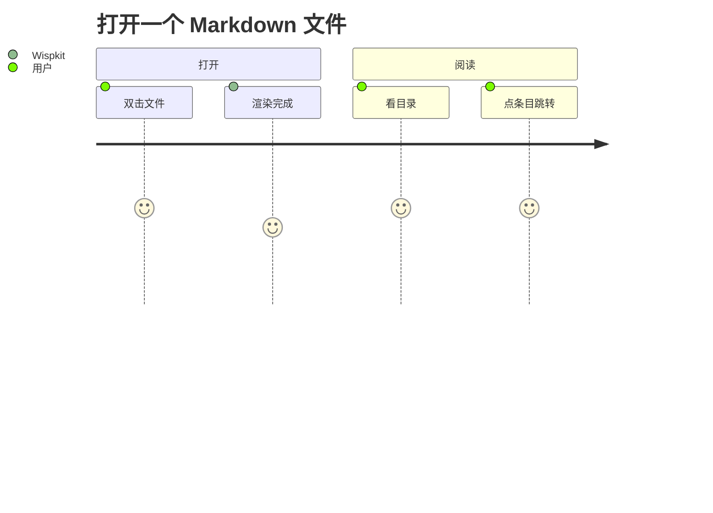
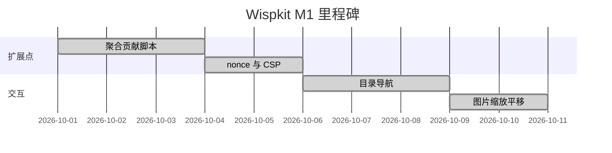
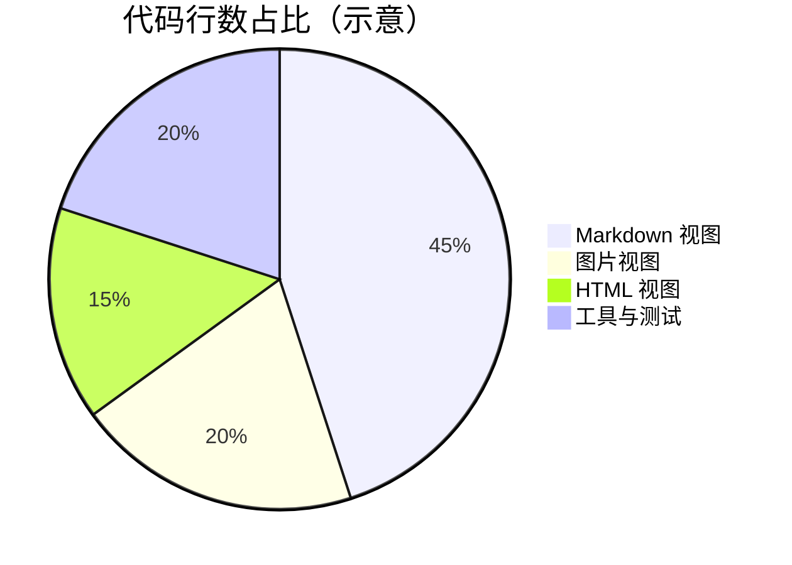
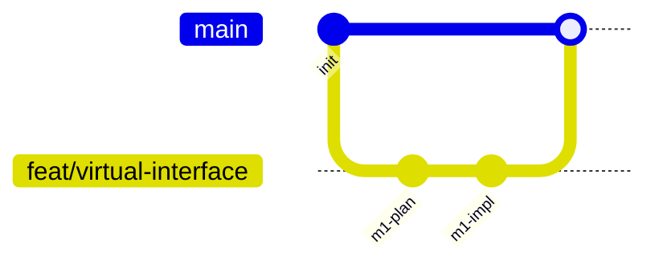

# R3-01 Mermaid 图类型覆盖

> **验证点**：Mermaid 图能渲染，且**默认就能缩放/平移**（不用按 Alt）。
> **怎么验放大**：
> 1. 在任意一张图上**直接滚轮** → 应该放大/缩小（这是 R3 的核心，旧行为是要按 Alt）
> 2. 在图上**按住左键拖动** → 应该平移
> 3. 鼠标移出图再滚 → 页面滚动（图不该吃掉页面的滚轮）
>
> **这一条是"配置默认值"而不是代码**：Wispkit 通过 `configurationDefaults` 把
> `markdown-mermaid.mouseNavigation.enabled` 抬成 `always`。
> **前提**：你没有**手动**设过这一项。如果你之前显式设成过 `false` 或 `ctrlCmd`，
> 用户设置优先级更高、会盖掉我们的默认值 —— 这时请手动改回 `always`。

## 1. flowchart（最常用）

## 2. sequenceDiagram

## 3. classDiagram

## 4. stateDiagram-v2

## 5. erDiagram

## 6. journey

## 7. gantt

## 8. pie

## 9. gitGraph

## 能力边界（不算失败）

| 图类型 | 说明 |
|---|---|
| `mindmap` / `timeline` / `quadrantChart` / `sankey-beta` | 只有较新的 Mermaid 才有。**内置扩展带的是哪个版本决定了有没有**——如果渲染成"语法错误"块，记下来即可，不是 Wispkit 的问题 |
| 语法错误图 | 见 `03-edge.md` |
