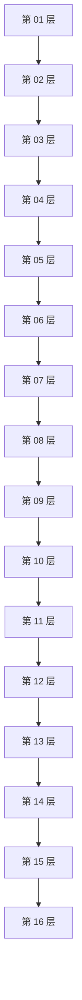
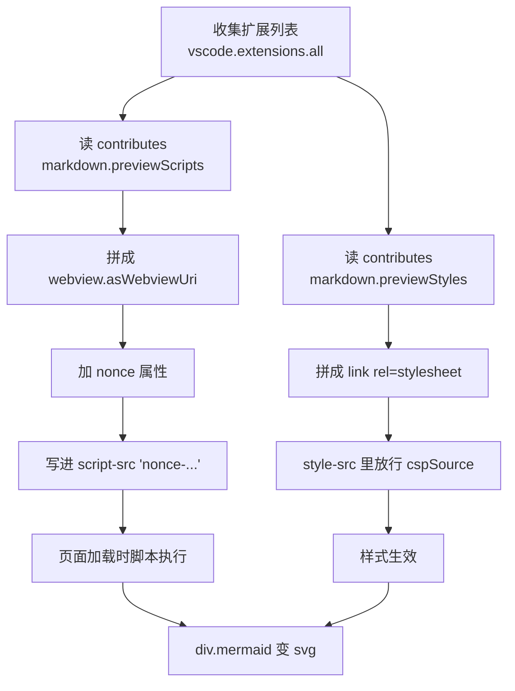

# R3-02 大图：验证缩放与平移真的可用

> **验证点**：图比视口大得多时，缩小能看全貌、放大能看细节、拖动能看到边界外的部分。
> **判据（按顺序做）**：
> 1. 打开本文件 → 两张图都应**完整可见**（自动适配）
> 2. 在宽图上**直接滚轮放大** 5 格 → 中间的节点变大；**放大时鼠标指哪就放大哪**（以光标为锚点，不是以中心）
> 3. 放大后**按住左键拖动** → 能看到原本在视口外的节点
> 4. 一直放大到很大 → 线条仍然锐利（SVG 不失真）

## 宽图（横向 12 个节点）

## 高图（纵向 16 层）

## 密集图（节点多 + 标签长，最容易暴露"适配算错"）

## 如果放大不工作，先查这三处

1. 设置里搜 `markdown-mermaid.mouseNavigation.enabled` —— 必须是 `always`；
   如果是 `ctrlCmd` 或 `false`，说明**你之前手动设过**，用户设置盖掉了 Wispkit 的默认值。
2. 是不是**没重启窗口**：装完扩展要 `Developer: Reload Window`。
3. 图本身是不是太窄：一张只有 2 个节点的图，适配后本来就是 100%，放大才看得出变化。
