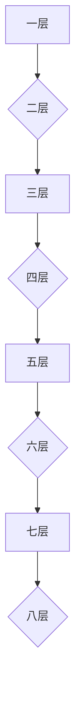

# R3-03 Mermaid 边界与容错

> **验证点**：一张图画不出来，**不能带崩整篇**。
> 这是渲染管线最容易出问题的地方：`markdownItPlugins` 只负责把 fence 转成 `<div class="mermaid">`，
> 真正的渲染由前端 mermaid 脚本做，所以**解析失败发生在运行时**。

## 1. 中文标签（含全角标点）

```mermaid
flowchart LR
  A【开始】--> B（判断条件）
  B -->|是，继续| C【结束】
  B -->|否，返回| A
```

**期望**：图形正常（全角括号在部分 Mermaid 版本里需要引号包裹，若渲染失败见第 4 条说明）。

## 2. 标签里有特殊字符（需要用引号）


**期望**：正常渲染。**这一条是最容易报语法错的形式**，也正是要看的。

## 3. 空 fence

```mermaid
```

**期望**：**不能让整篇崩掉**。可以是一块空白、也可以是报错，但下面的章节必须照常显示。

## 4. 语法错误

```mermaid
flowchart TD
  A[--> 这不是合法箭头
  ??? 完全没有结构的行
```

**期望**：这块图位置显示 Mermaid 的报错（通常是一行 `Syntax error in text` 之类），**其余部分正常**。

## 5. 只有单节点


**期望**：一个小框。适配后是 100%，放大才明显。

## 6. 极深嵌套（括号配平压力）



## 7. 非 mermaid 的 fence 不能被误伤

```text
graph LR
  A --> B
```

**期望**：这一段是**代码块**（我特意标注了 `text`），**不能**被渲染成图。
如果它变成了图，说明 fence 类型判断过宽。

## 8. 与前面几张图的隔离性检查

上面第 4 条如果出了错，**第 5～7 条以及本段必须依然正常显示**。
只要出现"从某张错图开始后面全白"，就是致命问题（前端脚本抛异常后没继续处理后续 div）。
