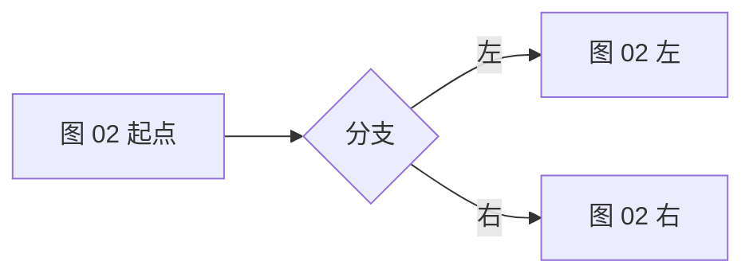
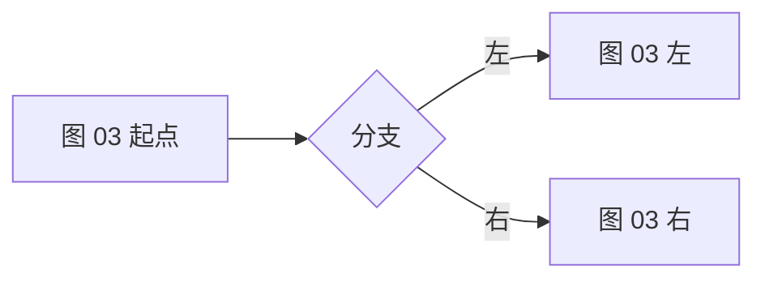
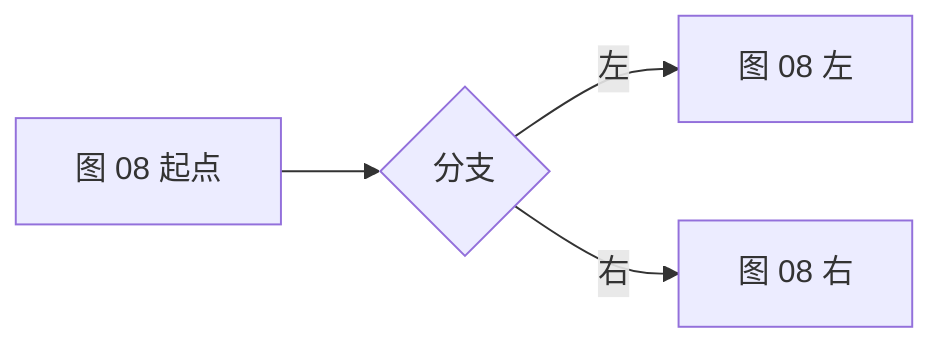
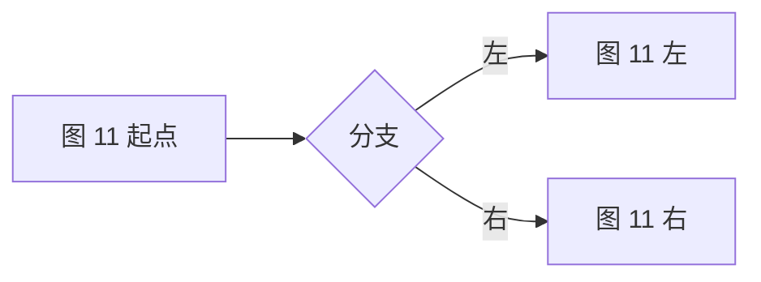
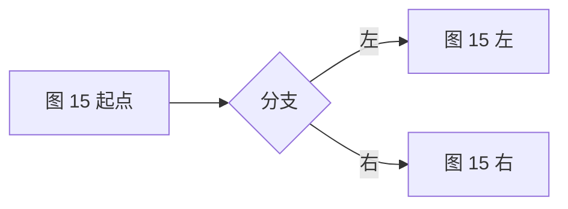

# R3-04 批量 Mermaid（验证一次渲染 20 张）

> **验证点**：多张图并存时，是否**每张都渲染**、是否互相干扰、是否拖慢滚动。
> **期望**：下面 20 张全部是图形；没有哪几张退化成代码块。
> **加练**：在文件末尾追加一个新 ```mermaid 块并保存 → 200ms 防抖后应**整篇重渲染**，
> 新图出现、其余 20 张仍然正常（重渲染走 `wispkit.update` → `content.innerHTML` → 派发 `vscode.markdown.updateContent`）。
> **规模**：由 `tools/gen-fixtures.mjs` 生成。

## 图 01


## 图 02



## 图 03



## 图 04


## 图 05


## 图 06


## 图 07


## 图 08



## 图 09


## 图 10


## 图 11



## 图 12


## 图 13


## 图 14


## 图 15



## 图 16


## 图 17


## 图 18


## 图 19


## 图 20


