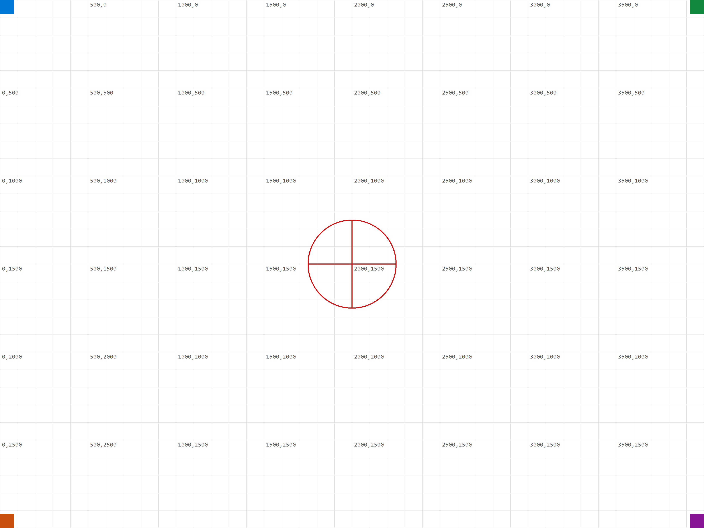
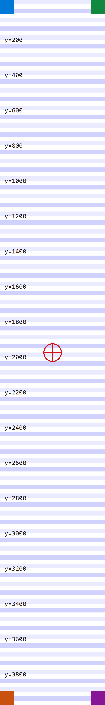
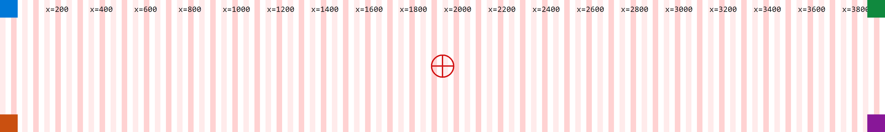
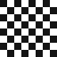
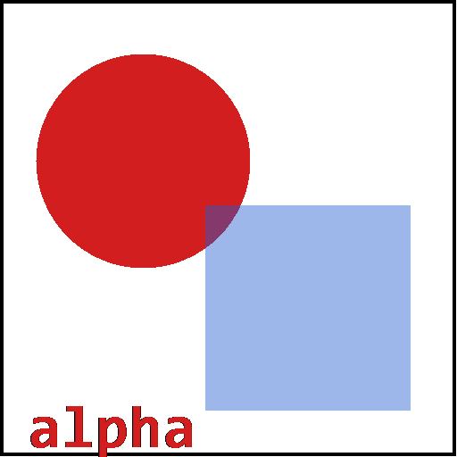
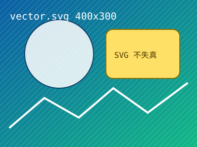
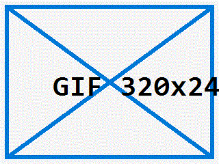

# R4-01 图片：在 Markdown 里显示 + 用图片视图看

> **前提**：请用 <em>File → Open Folder</em> 打开 `demo`。
> 下面的图都走 `../assets/images/…` 这种**跨目录**相对路径；只有文件夹模式才落在 webview 的
> `localResourceRoots` 里。**若全是裂图 → 说明你是单文件打开的**（这不是扩展的 bug，是 webview 的资源根限制）。

## 两种看法要分开验

| 想看什么 | 怎么打开 | 验证的功能 |
|---|---|---|
| 图在**文档里**显示 | 就这个文件，Markdown 视图 | R1/R4 的渲染与 `<base href>` 资源解析 |
| 图的**滚轮缩放 / 右键平移** | 图片文件上右键 → *Reopen Editor With…* → **Wispkit Image** | R4 的核心 |

## 1. 超大图（4000×3000）——验证"适配缩小"和"放大到细节"

- 在这里：应被**缩到文档宽度**，网格和坐标字仍可辨认
- 用 Wispkit Image 打开：应**完整可见**（fit），左下角提示 `xx% · 滚轮缩放 · 右键拖动平移 · 双击复位`
- 直接滚轮放大到 300% 以上 → 网格线应出现**像素化**（`image-rendering: pixelated` 在 ≥300% 时启用）
- **双击** → 在"适配"和"100%"之间切换

## 2. 极高图（600×4000）——验证 fit 取的是长边

用 Wispkit Image 打开：高度远大于视口 → 适配后**宽度不到视口一半**（因为要迁就高度）。

## 3. 极宽图（4000×600）——同上，反过来

## 4. 极小图（16×16）——关键边界：不该被放大超过 100%

**判据**：用 Wispkit Image 打开，提示里应显示 **`100%`**（而不是被拉大成几百 %）。
`fit()` 里有 `Math.min(视口/图宽, 视口/图高, 1)`，那个 `1` 就是这条规则。
**如果显示成 2000% 之类 → 那个上限没了，是缺陷。**

## 5. 棋盘小图（64×64）——验证 pixelated 阈值

放大到 300% 时，8px 的格子应变成**硬边方块**（能数出格子），不是模糊过渡。

## 6. 透明通道（512×512）

**判据**：图片周围应是**页面的背景色**（透明），不是白块；中间的红圆不透明、蓝方块半透明（能透出红圆）。

## 7. 其他格式（各一张，只验证"能打开"）

| 格式 | 文件 | 期望 |
|---|---|---|
| JPEG | `../assets/images/grid-4000x3000.jpg` | 能打开，格式为 jpg |
| BMP | `../assets/images/flat-800x600.bmp` | 能打开，三条色带 |
| GIF | `../assets/images/solid-320x240.gif` | 能打开 |
| ICO | `../assets/images/icon-64x64.ico` | 能打开 |
| WEBP | `../assets/images/grid-4000x3000.webp` | 能打开（若文件不存在见下） |
| AVIF | `../assets/images/grid-4000x3000.avif` | 能打开（若文件不存在见下） |

**关于 svg**：`../assets/images/vector-400x300.svg` **不在** image 视图的 selector 里
（`package.json` 的 `contributes.customEditors` 选择器是 `*.{png,jpg,jpe,jpeg,bmp,gif,ico,webp,avif}`，**没有 svg**）。
所以 svg 会用**内置**预览打开、也用不上这里的缩放平移。在 Markdown 里则正常显示：

> webp / avif 由 `tools/gen-webp-avif.mjs` 转换生成；本机没有系统级编码器（无 ImageMagick/cwebp/avifenc），
> 所以它们依赖 npm 的 `sharp`。**如果这两个文件不存在**，说明当时没跑转换，其余验证不受影响。

## 8. 一行里放多张（验证文档里的图片不互相影响）

  

**期望**：三张并排、各有各的尺寸，**缩放平移只作用于图片视图**，不影响 Markdown 文档里的显示。
