# R8-01 3D 图元素总览

> **验证点**：Markdown 里的 ASCII 树与多种 Mermaid 图都能被「3D 可视化浏览」收集成图元素，
> 下拉框名称按「标题 / title > 最近 Markdown 标题 > 第一个节点 > 文件名」生成。
>
> **怎么验**：
> 1. 在资源管理器里右键本文件 → **3D 可视化浏览**；
> 2. 左下拉应能看到 17 个左右的图元素，名称形如「1. ASCII 目录树（围栏 text） · ASCII 树」；
> 3. 逐个选择，确认 3D 场景里有节点与连线；本文件第 14 节是**未支持图种**，会显示「通用兜底」说明；
> 4. 第 16 节的树写在 ` ```js ` 围栏里，**不应**出现在下拉框中（不是图元素）。

## 1. ASCII 目录树（围栏 text）

```text
wispkit
├── src
│   ├── extension.ts
│   ├── graph3dProvider.ts
│   └── graph3d
│       ├── ascii.ts
│       ├── mermaid.ts
│       ├── markdownElements.ts
│       ├── merge.ts
│       └── layout.ts
├── media
│   ├── graph3d.js
│   └── graph3d.css
└── docs
    └── index.md
```

## 2. flowchart（frontmatter title）

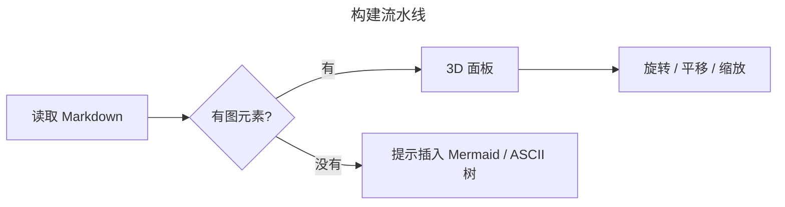

## 3. sequenceDiagram

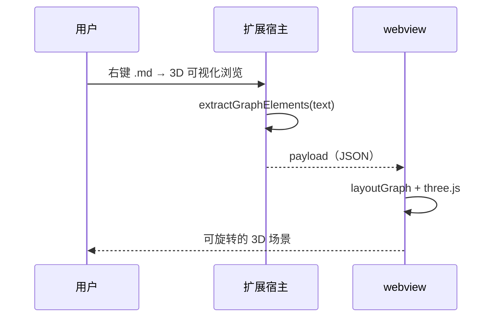

## 4. classDiagram

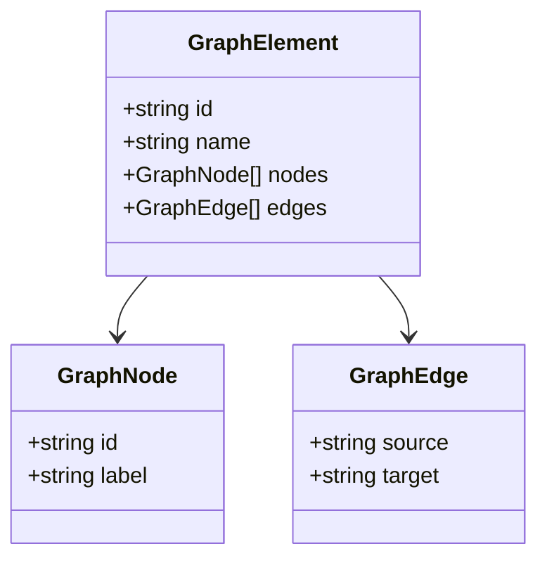

## 5. stateDiagram-v2

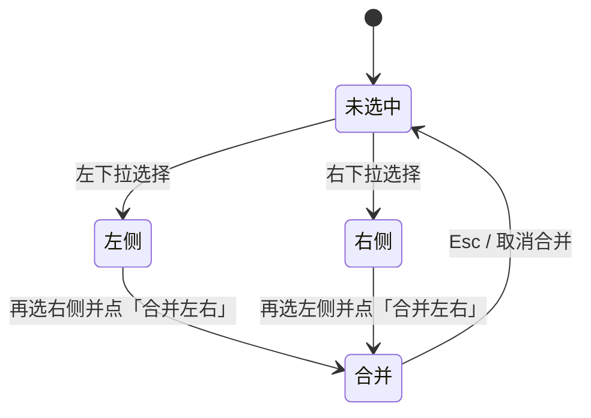

## 6. erDiagram

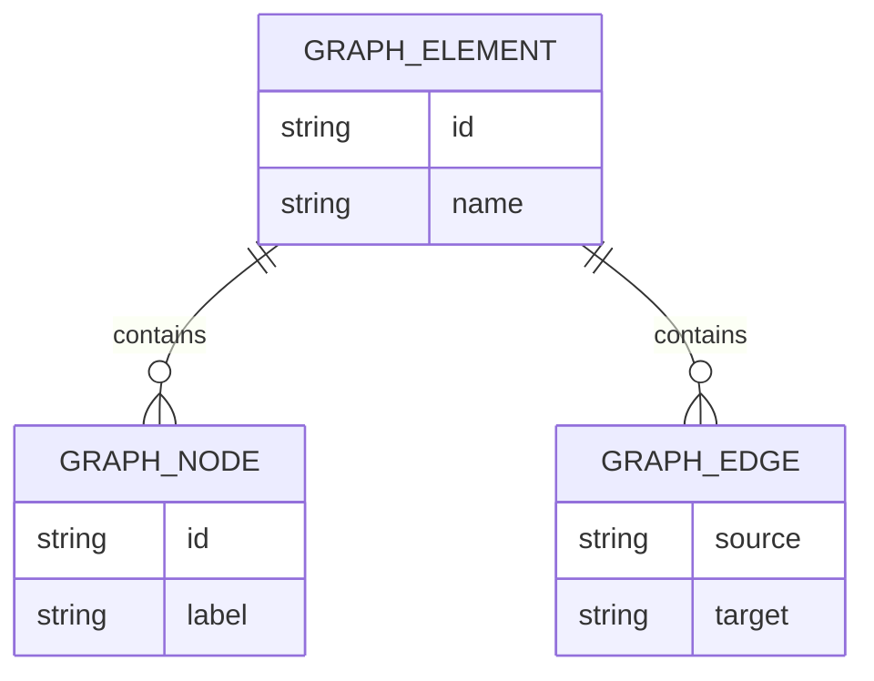

## 7. mindmap

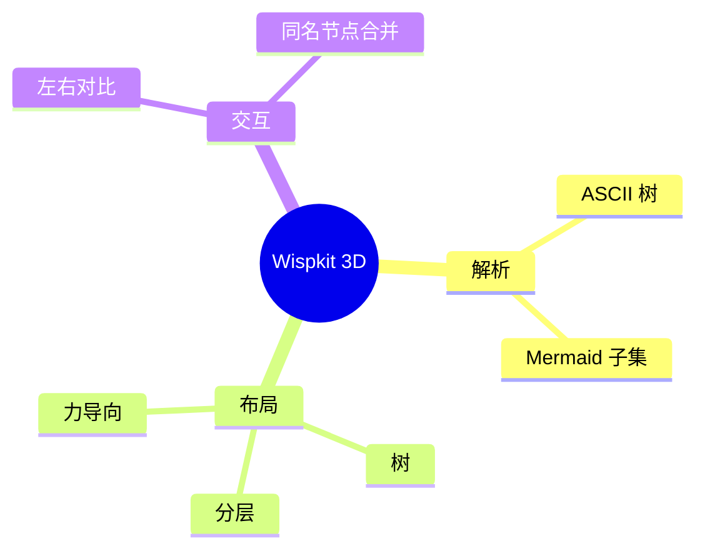

## 8. gitGraph

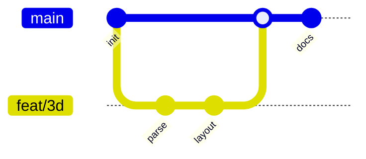

## 9. journey

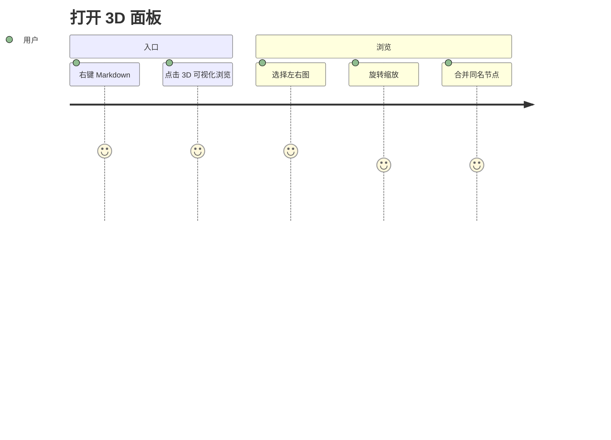

## 10. gantt

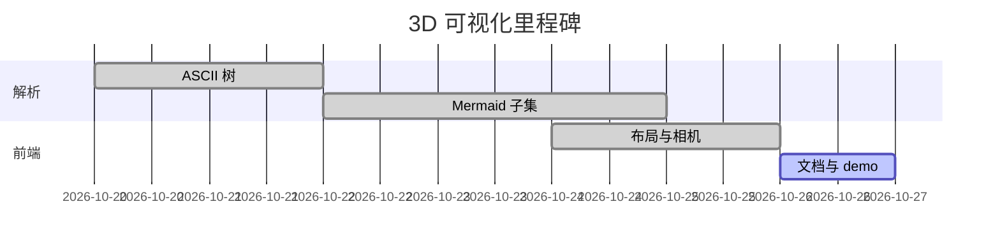

## 11. timeline

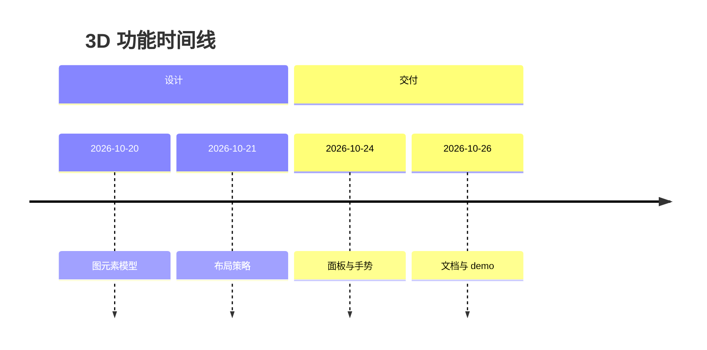

## 12. pie

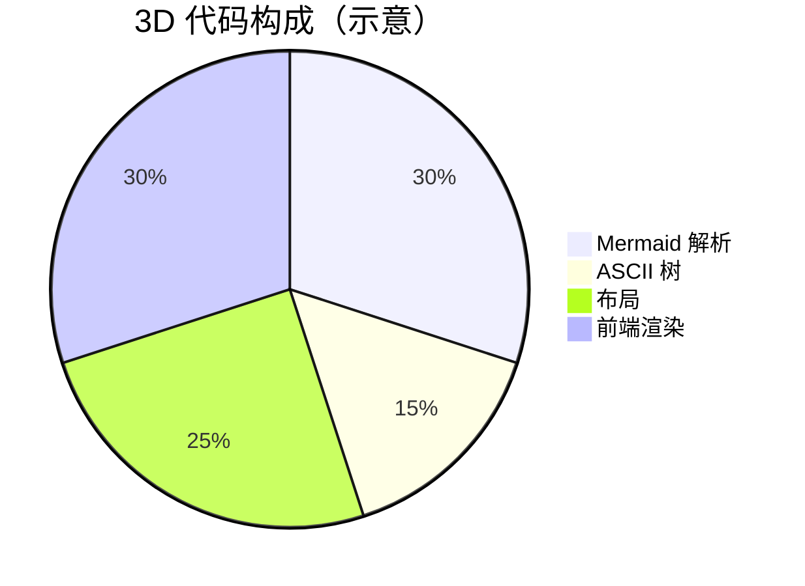

## 13. quadrantChart

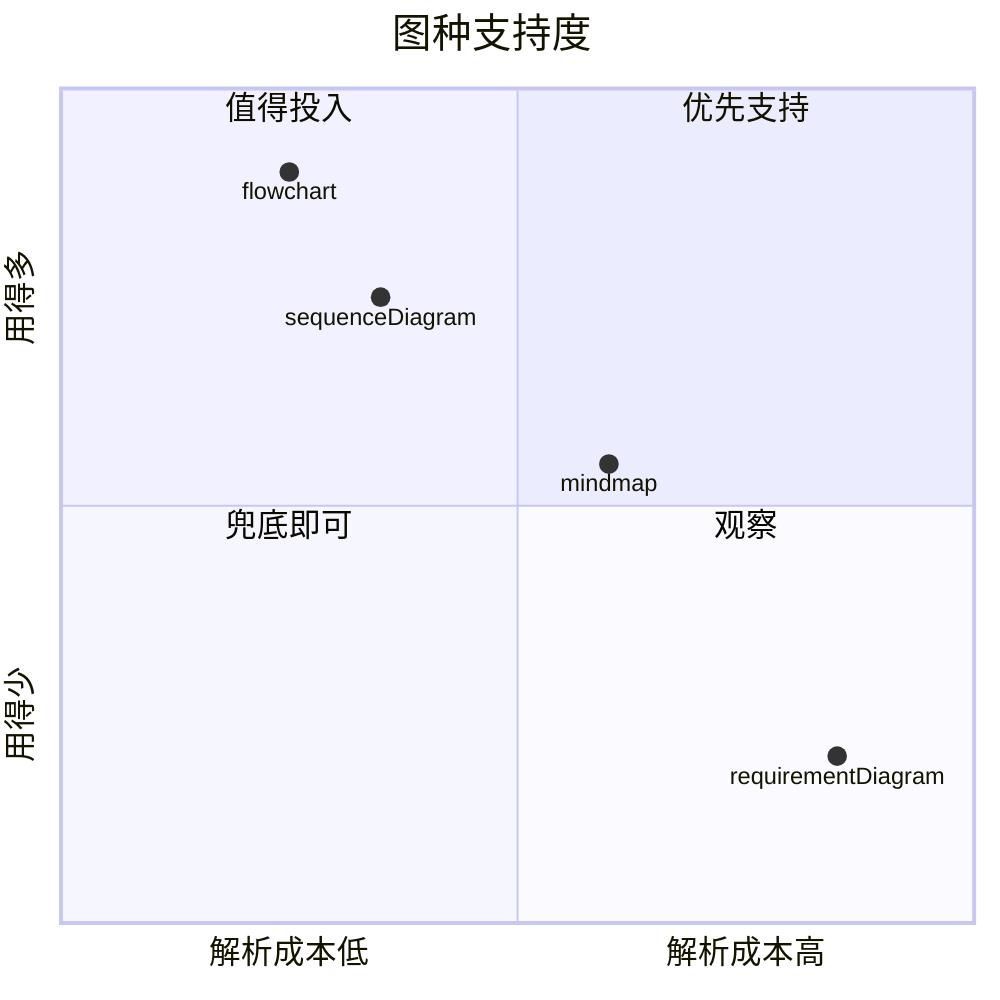

## 14. requirementDiagram（未支持图种，走通用兜底）

```mermaid
requirementDiagram
  requirement 可旋转 {
    id: 1
    text: 3D 场景必须能旋转
    risk: medium
    verifymethod: test
  }
  element 3D面板 {
    type: ui
  }
  3D面板 - satisfies -> 可旋转
```

## 15. 正文裸 ASCII 树（无围栏）

下面这棵树不在代码围栏里，靠「至少两行带标签连接线」被识别：

wispkit
├── 解析
│   ├── ascii.ts
│   └── mermaid.ts
├── 布局
│   └── layout.ts
└── 渲染
    └── graph3d.js

以上树在 3D 下拉框里应出现。

## 16. 非 ASCII 围栏里的树不会被收集（示例）

```js
// 这段文字长得像树，但语言是 js，不是图元素
wispkit
├── src
└── media
```

## 17. 同一个 Markdown 标题下两个 Mermaid 图：同名追加 (2)

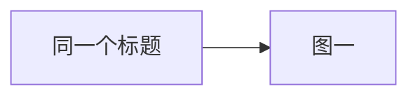

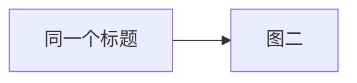

下拉框里这两项应显示为「… · 流程图」和「… · 流程图 (2)」。

## 预期结果

| 检查项 | 期望 |
|---|---|
| 图元素数量 | 第 1–15 节 + 第 17 节的两张图（第 16 节不算），共约 **17** 个 |
| 第 2 节名称 | 使用 frontmatter `title`，显示「构建流水线 · 流程图」 |
| 第 14 节统计 | 有节点 / 边，并带「通用兜底解析（按行串成链）」说明 |
| 第 15 节 | 出现在下拉框里，名称为「… · ASCII 树」 |
| 第 16 节 | **不出现**在下拉框里 |
| 第 17 节 | 两个名称仅差末尾的 `(2)` |
| 任意图 | 左键拖动旋转、右键拖动平移、滚轮缩放；「重置视角」复位 |
