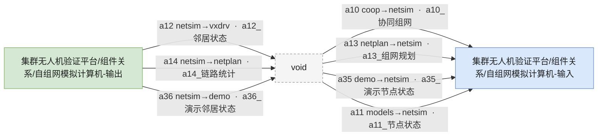
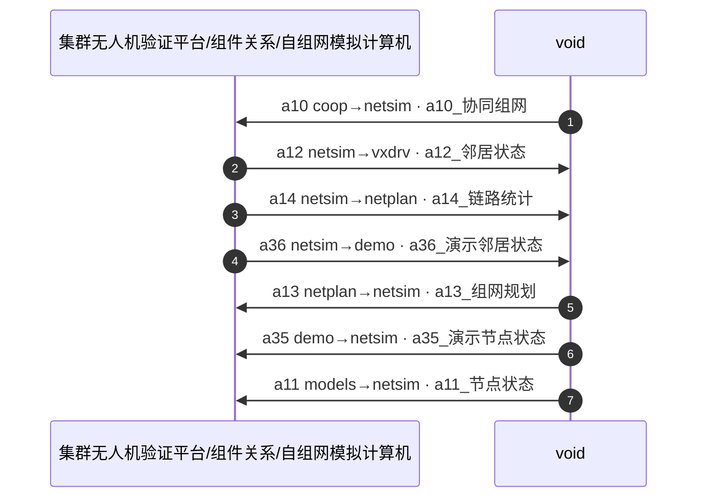

# void 悬空流

这个文件复现 Drawcode 导出的「模块交联」图：对侧模块没有创建时，导出器会用一个标签为
`void` 的占位节点收集悬空信号。3D 可视化浏览会把 `void` 当作**悬空占位**，不画气泡；
真实节点那一侧的流会变成伸向空处的半截箭头。

## 部署交联图

预期（3D 面板）：

- 只是 **2 个节点 / 7 条边**，下拉与统计行额外标注 **7 悬空**；不存在 `void` 气泡。
- `void_node → m1_in` 的四条流从 `m1_in` 周围的不同方向伸向空处，箭头指向 `m1_in`；
- `m1_out → void_node` 的三条流从 `m1_out` 向外伸出，箭头落在悬空端；
- 同一气泡周围的多条悬空流按角度散开，长度接近常规边距，不会挤成一束或长到穿进旁边的图。

## 时序图

预期：参与者 `PV` 不再出现；7 条消息围绕 `P1` 变成悬空消息，方向与长短按同样的规则分配。

## 不适用的情况

- ASCII 树里的 `void` 只是一个普通节点 / 文件名，不做悬空处理；
- 孤立、没有真实邻居的 `void` 节点会保留，不会被移除；
- 节点标签必须**恰好**是 `void`（忽略首尾空白与大小写）；`voided`、`my void` 等不触发。
